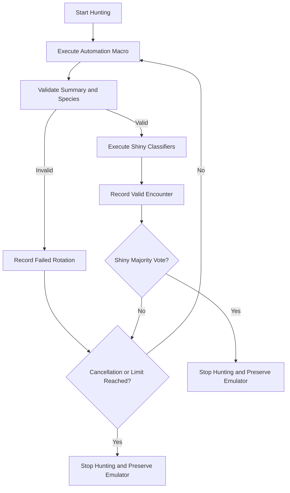
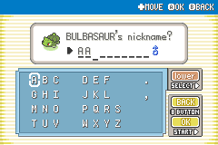
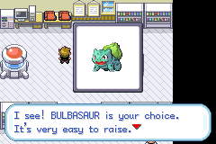
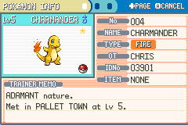
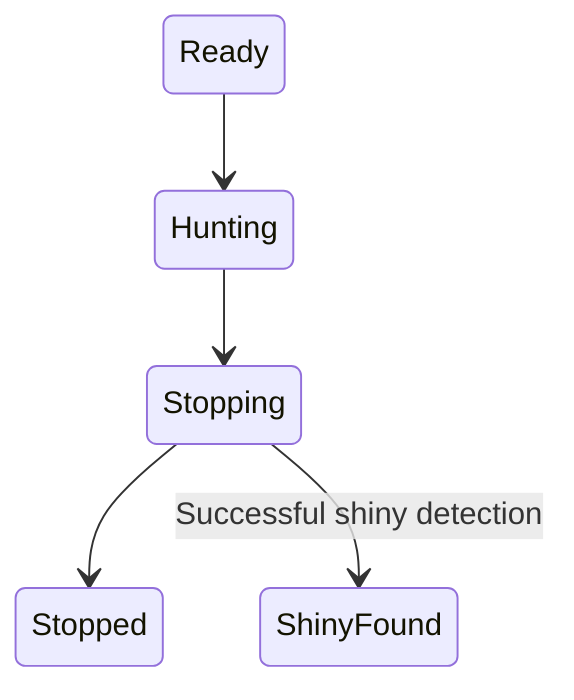
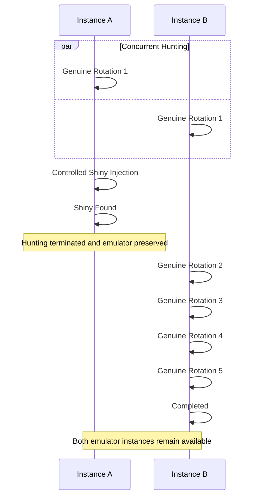

# Continuous Hunting Implementation and Verification

## Objective

Implement a continuous automated shiny hunting workflow that integrates emulator execution, computer vision classification, fault recovery, encounter tracking, automatic termination, and independent concurrent instance operation.

The hunting controller was designed to operate without user intervention while preserving the emulator state following a successful shiny detection or user cancellation.

## Implementation

| Component | Responsibility |
|---|---|
| `instances/hunting_controller.py` | Continuous hunting, lifecycle management, cancellation, termination, and throughput tracking. |
| `instances/library_manager.py` | Emulator execution, summary validation, shiny classification, and encounter statistics. |
| `tests/integration/test_hunting_controller.py` | Continuous hunting and controlled integration experiments. |

The hunting controller operates independently of the emulator implementation and computer vision classifiers.

No modifications to the established automation macro, classifier models, or validation regions were required.

### Hunting Lifecycle

| State | Description |
|---|---|
| Ready | Controller initialized and available to begin hunting. |
| Hunting | Automated rotations are actively executing. |
| Stopping | User cancellation has been requested. |
| Stopped | Hunting terminated following user cancellation. |
| Shiny Found | Hunting terminated following successful shiny classification. |
| Completed | Configured experimental rotation limit reached. |
| Error | An unexpected execution error occurred. |

### Automated Hunting Workflow

Invalid summaries bypass shiny classification and increment the failed rotation counter.

Valid normal encounters increment the valid encounter counter and permit another automated rotation.

A successful shiny prediction immediately terminates the affected hunting controller without executing another emulator reset.

The emulator instance remains available until explicitly closed.

## Continuous Hunting Verification

### Methodology

Five genuine automated Charmander encounters were executed using the existing `FireRed Starter` profile.

An optional rotation limit was configured to terminate the experiment after five completed rotations.

No framebuffer injections or simulated classification results were used during this experiment.

### Results

| Metric | Result |
|---|---:|
| Initiated rotations | 5 |
| Completed rotations | 5 |
| Valid encounters | 5 |
| Failed rotations | 0 |
| Consecutive failures | 0 |
| Shiny detections | 0 |
| Observed macro success rate | 100% |
| Total elapsed time | 27.0530 seconds |
| Average time per encounter | 5.4106 seconds |
| Encounters per minute | 11.0894 |
| Final hunting state | Completed |
| Execution errors | None |

All five genuine rotations successfully reached the expected summary screen and produced normal classifications.

The controller automatically initiated subsequent rotations without user intervention and terminated when the configured rotation limit was reached.

The final screenshot and emulator resources remained available following termination.

### Throughput Projection

The observed single-instance throughput corresponds to approximately 665 encounters per hour if the measured processing rate remains constant.

This value represents a projection from five genuine rotations rather than a sustained hourly performance measurement.

## Automatic Fault Recovery

### Methodology

The hunting controller was evaluated using two genuine macro executions and two controlled invalid framebuffer injections.

The invalid samples were obtained from the previously verified fault tolerance dataset.

### Nickname Entry Fault

### Starter Selection Fault

Both failure samples were injected between genuine automated encounters.

The controller was responsible for automatically initiating every subsequent rotation without external intervention.

The final recovery rotation executed the original FireRed automation macro, including the emulator reset.

### Results

| Rotation | Execution | Valid Encounters | Failed Rotations | Consecutive Failures |
|---|---|---:|---:|---:|
| 1 | Genuine encounter | 1 | 0 | 0 |
| 2 | Nickname entry injection | 1 | 1 | 1 |
| 3 | Starter selection injection | 1 | 2 | 2 |
| 4 | Genuine recovery encounter | 2 | 2 | 0 |

| Metric | Result |
|---|---:|
| Completed rotations | 4 |
| Genuine macro executions | 2 |
| Controlled fault injections | 2 |
| Successful fault rejections | 2 |
| Valid encounters | 2 |
| Failed rotations | 2 |
| Final consecutive failures | 0 |
| Total elapsed time | 9.3506 seconds |
| Final hunting state | Completed |
| Execution errors | None |

Both injected failure conditions were rejected without invoking the shiny classifiers.

The controller automatically initiated another rotation following each rejected summary.

The genuine recovery macro successfully reached the expected Charmander summary screen and reset the consecutive failure counter.

The accumulated failed rotation count remained unchanged following recovery.

The observed 50% rotation success rate resulted from deliberately introducing two invalid rotations and does not represent the reliability of the established automation macro.

The experiment verified automatic retry behavior following controlled invalid framebuffer inputs. The injected faults did not represent naturally occurring failures within the live emulator.

## Automatic Stop-on-Shiny

### Methodology

The controller was configured to execute a maximum of ten rotations.

The first rotation executed the genuine FireRed automation macro.

The second rotation supplied a previously verified shiny Charmander evaluation capture to the existing summary validator and shiny classifiers.

The classification result was not simulated. The injected image was processed using the original border, star, and palette classifiers.

The experiment verified whether the controller terminated following a successful shiny classification and prevented subsequent macro execution.

### Results

| Rotation | Execution | Border | Star | Palette | Votes | Prediction |
|---|---|---|---|---|---:|---|
| 1 | Genuine encounter | Normal | Normal | Normal | 0/3 | Normal |
| 2 | Controlled shiny injection | Shiny | Shiny | Shiny | 3/3 | Shiny |

| Metric | Result |
|---|---:|
| Configured rotation limit | 10 |
| Completed rotations | 2 |
| Genuine encounters | 1 |
| Controlled shiny injections | 1 |
| Valid classifications | 2 |
| Failed rotations | 0 |
| Recorded shiny detections | 1 |
| Subsequent rotations | 0 |
| Total elapsed time | 4.4960 seconds |
| Final hunting state | Shiny Found |
| Execution errors | None |

The injected shiny sample passed summary validation and received unanimous shiny predictions from all three classifiers.

The controller terminated before reaching the configured rotation limit.

No additional macro rotations or emulator resets occurred following the successful classification.

The detection screenshot, classification result, emulator core, and temporary instance directory remained available following termination.

Because the shiny framebuffer was injected, the experiment verified automatic termination and emulator resource preservation rather than preservation of an actual shiny Pokemon within the live game state.

## User Cancellation

### Methodology

The hunting controller was executed within a separate worker thread.

Thread synchronization was used to issue a cancellation request after the controller initiated its first rotation but before the genuine macro proceeded.

The active rotation was then permitted to complete normally.

Cancellation was implemented cooperatively using a threading event rather than forcibly terminating the emulator or hunting thread.

### Lifecycle Transitions

A successful shiny detection takes priority over a pending cancellation request.

This prevents a successful final encounter from being discarded solely because the user requested cancellation during that rotation.

### Results

| Metric | Result |
|---|---:|
| Initiated rotations | 1 |
| Completed rotations | 1 |
| Valid encounters | 1 |
| Failed rotations | 0 |
| Subsequent rotations | 0 |
| Total elapsed time | 4.3707 seconds |
| Final hunting state | Stopped |
| Execution errors | None |

The cancellation request successfully transitioned the controller from Hunting to Stopping.

The current rotation completed and produced a valid normal Charmander classification.

The controller subsequently transitioned to Stopped without initiating another rotation.

The hunting worker terminated successfully while the emulator resources and final screenshot remained available.

Cancellation was verified at rotation boundaries. Immediate interruption of an executing macro was not implemented.

The successful shiny detection priority was defined in the controller but was not exercised during this cancellation experiment.

## Concurrent Hunting Verification

### Methodology

Two independent hunting controllers were initialized using the same permanent `FireRed Starter` profile.

Each instance maintained its own:

- Unique temporary instance directory.
- Temporary ROM copy.
- Temporary battery save.
- Emulator core and framebuffer.
- Computer vision detector.
- Hunting controller and cancellation event.
- Rotation and encounter statistics.

Both hunting controllers were executed using separate worker threads.

Instance A executed one genuine macro rotation followed by a controlled shiny Charmander injection.

Instance B executed five genuine macro rotations.

Thread synchronization ensured that Instance B initiated additional rotations after Instance A terminated.

### Instance Configuration

| Property | Instance A | Instance B |
|---|---|---|
| Instance ID | cd433ce9 | 348441a5 |
| Permanent profile | FireRed Starter | FireRed Starter |
| Target species | Charmander | Charmander |
| Species identifier | 004 | 004 |
| Rotation limit | 10 | 5 |
| Controlled shiny injection | Rotation 2 | None |

### Individual Results

| Metric | Instance A | Instance B |
|---|---:|---:|
| Initiated rotations | 2 | 5 |
| Completed rotations | 2 | 5 |
| Genuine encounters | 1 | 5 |
| Controlled shiny injections | 1 | 0 |
| Valid classifications | 2 | 5 |
| Failed rotations | 0 | 0 |
| Consecutive failures | 0 | 0 |
| Recorded shiny detections | 1 | 0 |
| Elapsed time | 5.2879 seconds | 27.9016 seconds |
| Final hunting state | Shiny Found | Completed |
| Execution errors | None | None |

### Concurrent Execution Sequence

Instance A successfully detected the injected shiny Charmander and terminated hunting after its second rotation.

Instance B continued hunting independently and completed rotations 2, 3, 4, and 5 after Instance A terminated.

The preserved Instance A emulator remained available throughout these subsequent rotations.

### Aggregate Results

| Metric | Result |
|---|---:|
| Concurrent instances | 2 |
| Completed rotations | 7 |
| Genuine macro executions | 6 |
| Controlled shiny injections | 1 |
| Valid classifications | 7 |
| Failed rotations | 0 |
| Recorded shiny detections | 1 |
| Additional Instance B rotations after Instance A terminated | 4 |
| Execution errors | 0 |

Both instances maintained independent encounter counters and computer vision detector objects.

Instance A retained its successful detection screenshot and classification results while Instance B continued hunting.

Following termination of both hunting controllers, Instance A was explicitly closed.

Instance B's emulator resources and temporary instance directory remained available after Instance A was removed.

Both instances were subsequently closed, and all associated temporary instance directories were removed successfully.

### Concurrent Performance Considerations

The concurrent experiment included controlled framebuffer injection and deliberate thread synchronization.

Consequently, the reported individual encounter throughput measurements were excluded from concurrent scalability analysis.

The experiment established independent concurrent operation and termination rather than maximum hunting throughput.

Concurrent execution at the intended maximum of ten emulator instances remains subject to additional system-level evaluation.

## Resource and Profile Preservation

Permanent battery saves and profile metadata were recorded before each experiment and compared following emulator termination and temporary instance cleanup.

| Experiment | Emulator Preserved Following Hunting | Temporary Cleanup | Permanent Save Preserved | Metadata Preserved |
|---|---|---|---|---|
| Continuous hunting | PASS | PASS | PASS | PASS |
| Automatic fault recovery | PASS | PASS | PASS | PASS |
| Automatic stop-on-shiny | PASS | PASS | PASS | PASS |
| User cancellation | PASS | PASS | PASS | PASS |
| Concurrent hunting | PASS | PASS | PASS | PASS |

All permanent battery saves and profile metadata remained byte-for-byte identical following the experiments.

The controller does not automatically destroy emulator resources when hunting terminates.

Explicit emulator closure releases the temporary resources without modifying the original permanent profile.

## Aggregate Verification

| Experiment | Result |
|---|---|
| Continuous automated hunting | PASS |
| Automatic continuation following normal encounters | PASS |
| Automatic fault recovery | PASS |
| Consecutive failure counter recovery | PASS |
| Automatic stop-on-shiny | PASS |
| Prevention of subsequent macro execution | PASS |
| Cooperative user cancellation | PASS |
| Independent concurrent hunting | PASS |
| Continued hunting following another instance's termination | PASS |
| Independent encounter tracking | PASS |
| Independent computer vision detectors | PASS |
| Emulator resource preservation | PASS |
| Independent instance cleanup | PASS |
| Permanent save and metadata preservation | PASS |

All five integration experiments completed successfully with no unexpected execution errors.

## Limitations

- Continuous hunting throughput was initially measured using five genuine rotations.
- Automatic fault recovery was evaluated using controlled invalid framebuffer injections followed by genuine macro execution.
- Shiny termination was evaluated using controlled shiny framebuffer injections rather than naturally encountered shiny Pokemon.
- Preservation of an actual shiny Pokemon within the live emulator game state remains unverified.
- User cancellation takes effect at rotation boundaries rather than interrupting an active macro.
- The simultaneous occurrence of cancellation and successful shiny detection was not experimentally evaluated.
- Concurrent hunting was verified using two instances of the same FireRed profile.
- The concurrent experiment included deliberate synchronization and was not intended to establish scalability or maximum throughput.
- Console output from concurrent workers occasionally interleaved because a centralized instance-specific logging mechanism was not implemented.
- Broader lifecycle race conditions and unexpected execution error handling remain subject to additional testing.
- Manual takeover and successful encounter save export remain unverified.

## Conclusion

The continuous hunting controller successfully integrated automated emulator rotations, computer vision classification, encounter tracking, fault recovery, automatic termination, and cooperative cancellation.

The concurrent hunting experiment demonstrated that one instance could terminate following a successful shiny classification while another instance continued executing independent automated encounters.

Emulator resources remained available following hunting termination, and permanent save profiles remained unchanged throughout all experiments.

These results established the autonomous hunting functionality required for manual takeover, successful encounter preservation, and production graphical interface integration.