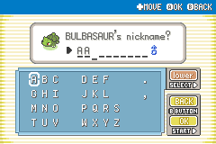
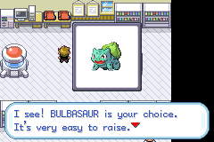

# Fault Tolerance Validation

## Objective

Verify that the summary validator correctly identifies unsuccessful macro rotations before shiny classification occurs.

Invalid game states must be distinguished from valid Pokémon summary screens to prevent unsuccessful rotations from being counted as valid encounters.

## Failure Conditions

Two representative failure conditions were selected based on previously observed macro reliability testing.

### Nickname Entry

The nickname entry screenshot was retained from an actual failed macro rotation.

Although the expected Pokémon sprite is present, the macro failed to reach the required summary screen.

### Starter Selection Confirmation

The starter selection confirmation screen was manually captured to reproduce a previously observed macro failure condition.

The expected Pokémon sprite and selection dialogue are present, but the required summary interface is absent.

## Testing Methodology

Both screenshots were captured at the native emulator framebuffer resolution of 240 x 160 pixels.

Each screenshot was evaluated against all three supported FireRed starter configurations using the existing summary validator.

Neither screenshot was included in classifier training or validation template initialization.

The expected result for every comparison was rejection.

## Validation Results

| Failure Condition | Bulbasaur | Charmander | Squirtle |
|---|---|---|---|
| Nickname entry | Rejected | Rejected | Rejected |
| Starter selection confirmation | Rejected | Rejected | Rejected |

### Aggregate Results

| Metric | Result |
|---|---:|
| Unique invalid captures | 2 |
| Actual failed rotation captures | 1 |
| Controlled negative samples | 1 |
| Total validation comparisons | 6 |
| Successful rejections | 6 |
| Incorrect acceptances | 0 |
| Observed rejection rate | 100% |
| Average rejection time | 0.0081 ms |

Both failure conditions were successfully rejected across all three supported starter configurations.

The six comparisons represent two unique invalid screenshots rather than six independently failed macro rotations.

## Fault Recovery

The intended automated hunting behavior following an invalid summary is to:

- Bypass shiny classification.
- Increment the failed rotation counter.
- Preserve the valid encounter counter.
- Reset the affected emulator instance.
- Restart the automation macro.
- Allow other concurrent instances to continue uninterrupted.

Automatic fault recovery remains subject to live hunting integration and verification.

## Limitations

The validation experiment covers the two representative failure conditions previously observed during macro reliability testing.

Rejection performance across other invalid game states has not been established.

Successful fault detection does not independently establish successful automatic fault recovery.

## Conclusion

The summary validator successfully rejected both representative macro failure conditions with minimal computational overhead.

These results establish the fault detection mechanism required for automatic macro recovery and accurate encounter tracking during continuous shiny hunting.