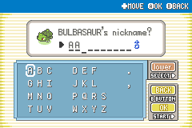
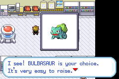

# Live Validation and Encounter Tracking

## Objective

Integrate summary screen validation into the live computer vision pipeline and implement independent encounter tracking for each emulator instance.

The implementation distinguishes successful encounters from failed macro rotations, prevents classification of invalid game states, and establishes the statistical tracking required for continuous automated shiny hunting.

## Implementation

| Component | Responsibility |
|---|---|
| `instances/library_manager.py` | Live summary validation, classification control, and rotation statistics. |
| `vision/shiny_detector.py` | Summary validation interface and combined shiny classification. |
| `vision/summary_validator.py` | Summary screen and target species verification. |
| `tests/integration/test_vision_integration.py` | Live validation, controlled fault injection, and encounter counter verification. |

## Live Classification Pipeline

Following macro execution, the emulator framebuffer is retrieved and converted into OpenCV's BGR image format.

The framebuffer is validated before being supplied to the shiny classifiers.

```python
valid_summary = self.detector.validate_summary(
    image,
    self.target_species
)
```

If validation succeeds, the image is processed by the existing three shiny classifiers using strict majority voting.

If validation fails, classification is bypassed entirely.

### Rotation Outcomes

| Rotation Outcome | Classification | Encounter Counter | Failed Rotation Counter |
|---|---|---|---|
| Valid normal summary | Normal | Increment | Unchanged |
| Valid shiny summary | Shiny | Increment | Unchanged |
| Invalid summary | Bypassed | Unchanged | Increment |
| Incorrect species | Bypassed | Unchanged | Increment |

Invalid summaries return undefined classification values rather than negative shiny predictions.

```python
{
    "valid_summary": False,
    "border": None,
    "star": None,
    "palette": None,
    "votes": None,
    "is_shiny": None
}
```

This distinction prevents invalid game states from being incorrectly represented as normal Pokémon encounters.

## Encounter Tracking

Each emulator instance maintains its own rotation and encounter statistics.

| Counter | Description |
|---|---|
| Attempts | Total macro rotations initiated. |
| Completed rotations | Rotations that completed validation and processing. |
| Valid encounters | Successfully validated and classified encounters. |
| Failed rotations | Rotations rejected by summary validation. |
| Consecutive failures | Number of uninterrupted failed rotations. |
| Shinies found | Valid encounters classified as shiny. |

Rotation statistics are updated only when a classified macro rotation is completed.

Repeated classification of the same framebuffer does not increment encounter or rotation counters.

### Counter Consistency

Completed rotations must equal the combined number of valid encounters and failed rotations.

```python
completed_rotations == valid_encounters + failed_rotations
```

Macro success rate is calculated as:

```python
success_rate = (
    valid_encounters / completed_rotations
) * 100
```

The consecutive failure counter increments following each rejected rotation and returns to zero following a valid encounter.

## Testing Methodology

The integration experiment consisted of four rotations using the same emulator instance.

One genuine automated encounter was executed, followed by two controlled invalid framebuffer injections and a valid framebuffer injection.

The genuine encounter was generated using the permanent `FireRed TEST Bulbasaur` profile.

| Rotation | Test Condition | Sample Type |
|---|---|---|
| 1 | Valid Bulbasaur summary | Genuine automated encounter |
| 2 | Nickname entry screen | Controlled fault injection |
| 3 | Starter selection confirmation | Controlled fault injection |
| 4 | Valid Bulbasaur summary | Controlled recovery injection |

The invalid screenshots were obtained from the previously verified fault tolerance samples.

### Nickname Entry Fault



### Starter Selection Fault



Controlled framebuffer injection allowed the validation and counter behavior to be tested without modifying the established automation macro or waiting for naturally occurring failures.

The shiny classifier prediction method was monitored during invalid rotations to verify that classification was completely bypassed.

## Experimental Results

### Counter Progression

| Rotation | Completed Rotations | Valid Encounters | Failed Rotations | Consecutive Failures | Shinies Found |
|---|---:|---:|---:|---:|---:|
| Initial state | 0 | 0 | 0 | 0 | 0 |
| Valid encounter | 1 | 1 | 0 | 0 | 0 |
| Nickname entry fault | 2 | 1 | 1 | 1 | 0 |
| Starter selection fault | 3 | 1 | 2 | 2 | 0 |
| Valid summary recovery | 4 | 2 | 2 | 0 | 0 |

Both invalid framebuffer injections were successfully rejected.

The valid encounter counter remained unchanged during both failed rotations, while the failed rotation and consecutive failure counters increased correctly.

Following the valid summary recovery injection, the consecutive failure counter returned to zero without removing the accumulated failed rotation count.

### Classification Bypass

| Invalid Screen | Summary Validation | Shiny Classification |
|---|---|---|
| Nickname entry | Rejected | Bypassed |
| Starter selection confirmation | Rejected | Bypassed |

Neither invalid framebuffer was processed by the shiny classifiers.

No invalid shiny predictions or additional valid encounters were recorded.

### Repeated Classification Verification

Following the valid summary recovery injection, the same framebuffer was classified 100 additional times.

The instance statistics were recorded before and after repeated classification.

All rotation and encounter counters remained unchanged.

This verifies that framebuffer classification and encounter tracking remain separate operations.

### Final Statistics

| Metric | Expected | Observed |
|---|---:|---:|
| Attempts | 4 | 4 |
| Completed rotations | 4 | 4 |
| Valid encounters | 2 | 2 |
| Failed rotations | 2 | 2 |
| Consecutive failures | 0 | 0 |
| Shinies found | 0 | 0 |
| Macro success rate | 50% | 50% |

The observed 50% success rate resulted from deliberately injecting two invalid rotations into the four-rotation experiment.

It does not represent the reliability of the established automation macro.

### Resource and Save Preservation

| Verification | Result |
|---|---|
| Emulator resource cleanup | PASS |
| Temporary instance directory removal | PASS |
| Permanent battery save preservation | PASS |

The permanent battery save remained byte-for-byte identical following the complete integration experiment.

## Concurrent Execution Considerations

Rotation statistics are maintained independently within each emulator instance.

This allows concurrent hunting instances to track their own encounter progress, failed rotations, consecutive failures, and successful shiny detections.

The intended application supports up to ten simultaneous hunting instances, including mixed FireRed and Sapphire workloads.

Independent instance statistics provide the foundation for displaying individual and aggregate hunting progress within the graphical interface.

Concurrent performance at the intended maximum instance count remains subject to experimental verification.

## Limitations

- The integration experiment included one genuine automated encounter and three controlled framebuffer injections.
- The two valid classification events do not represent two independently generated Pokémon encounters.
- Controlled recovery established correct counter behavior following an invalid rotation but did not verify automatic emulator reset and macro restart.
- Live shiny-positive encounter handling remains unverified.
- Aggregate statistics across concurrent hunting instances have not yet been implemented.
- Additional invalid game states may require further validation testing.

## Conclusion

Live summary validation was successfully integrated into the computer vision classification pipeline.

Both representative macro failure conditions were rejected without invoking the shiny classifiers or incrementing the valid encounter counter.

Independent rotation statistics correctly tracked successful encounters, failed rotations, consecutive failures, and recovery following a valid summary.

Repeated framebuffer classification did not introduce duplicate encounter counts, and the original permanent battery save remained unchanged.

These results establish the validation and statistical tracking mechanisms required for continuous automated shiny hunting, automatic fault recovery, and concurrent instance monitoring.