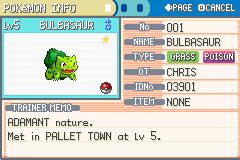
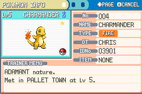
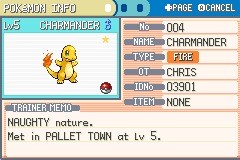
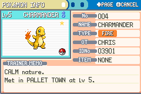
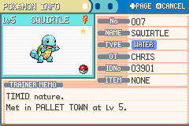
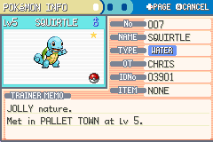
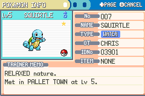

# Independent Shiny Evaluation

## Objective

Evaluate the ability of the combined shiny detector to correctly identify shiny Pokémon outside the original classifier reference dataset.

Previous evaluation established successful classification of 140 normal encounters. However, shiny-positive classification had only been verified using the original reference captures.

Additional shiny samples were generated to evaluate false-negative behavior without modifying or retraining the existing classifiers.

## Evaluation Dataset

Nine additional shiny Pokémon samples were generated using PKHeX and captured through the mGBA emulator at its native framebuffer resolution of 240 x 160 pixels.

Three samples were generated for each supported FireRed starter, incorporating variations in Pokémon nature and gender.

| Species | Species ID | Samples | Nature Variations |
|---|---|---:|---|
| Bulbasaur | 001 | 3 | Hasty, Sassy, Adamant |
| Charmander | 004 | 3 | Adamant, Naughty, Calm |
| Squirtle | 007 | 3 | Relaxed, Timid, Jolly |
| Total | | 9 | |

The evaluation captures were stored separately from the original classifier references.

```text
dataset/
└── firered_leafgreen/
    └── evaluation/
        └── shiny/
            ├── 001_01.png
            ├── 001_02.png
            ├── 001_03.png
            ├── 004_01.png
            ├── 004_02.png
            ├── 004_03.png
            ├── 007_01.png
            ├── 007_02.png
            └── 007_03.png
```

None of the additional samples were used during classifier training or validation template initialization.

## Evaluation Samples

### Bulbasaur

| Sample 1 | Sample 2 | Sample 3 |
|---|---|---|
|  |  |  |

### Charmander

| Sample 1 | Sample 2 | Sample 3 |
|---|---|---|
|  |  |  |

### Squirtle

| Sample 1 | Sample 2 | Sample 3 |
|---|---|---|
|  |  |  |

## Evaluation Methodology

The evaluation was implemented in `tests/vision/test_shiny_evaluation.py`.

Each evaluation image was loaded at its original framebuffer resolution and processed using the existing summary validator and combined shiny detector.

The following operations were performed for each sample:

- Verified the image resolution.
- Validated the summary interface and expected species.
- Evaluated the border classifier.
- Evaluated the star classifier.
- Evaluated the palette classifier.
- Verified majority voting consistency.
- Recorded the final classification.
- Measured validation and classification processing times.

The combined detector retained its existing strict majority voting requirement.

At least two of the three classifiers were required to produce a shiny prediction for successful detection.

No classifiers, reference images, validation regions, or classification thresholds were modified.

## Experimental Results

### Individual Sample Results

| Sample | Summary Validation | Border | Star | Palette | Votes | Prediction |
|---|---|---|---|---|---:|---|
| 001_01 | Accepted | Shiny | Shiny | Shiny | 3/3 | Shiny |
| 001_02 | Accepted | Shiny | Shiny | Shiny | 3/3 | Shiny |
| 001_03 | Accepted | Shiny | Shiny | Shiny | 3/3 | Shiny |
| 004_01 | Accepted | Shiny | Shiny | Shiny | 3/3 | Shiny |
| 004_02 | Accepted | Shiny | Shiny | Shiny | 3/3 | Shiny |
| 004_03 | Accepted | Shiny | Shiny | Shiny | 3/3 | Shiny |
| 007_01 | Accepted | Shiny | Shiny | Shiny | 3/3 | Shiny |
| 007_02 | Accepted | Shiny | Shiny | Shiny | 3/3 | Shiny |
| 007_03 | Accepted | Shiny | Shiny | Shiny | 3/3 | Shiny |

All nine evaluation samples were accepted by the summary validator and received unanimous shiny predictions.

### Individual Classifier Performance

| Classifier | Successful Detections | Total Samples | Observed Recall |
|---|---:|---:|---:|
| Border | 9 | 9 | 100% |
| Star | 9 | 9 | 100% |
| Palette | 9 | 9 | 100% |
| Combined detector | 9 | 9 | 100% |

No classifier disagreements were observed during the evaluation.

### Aggregate Shiny Evaluation Results

| Metric | Result |
|---|---:|
| Total shiny samples | 9 |
| Accepted summaries | 9 |
| Rejected summaries | 0 |
| Summary acceptance rate | 100% |
| True positives | 9 |
| Classification false negatives | 0 |
| Total missed shiny samples | 0 |
| Observed classifier recall | 100% |
| End-to-end shiny detection rate | 100% |

The additional evaluation samples demonstrated that variations in nature and gender did not interfere with the selected classification and validation regions within the evaluated dataset.

## Cumulative Classification Performance

The additional shiny evaluation results were combined with the previously evaluated 140 normal encounter captures.

The original six reference images were excluded from these cumulative classification results because they were used during classifier initialization.

### Evaluation Distribution

| Species | Normal Samples | Shiny Samples | Total |
|---|---:|---:|---:|
| Bulbasaur | 100 | 3 | 103 |
| Charmander | 20 | 3 | 23 |
| Squirtle | 20 | 3 | 23 |
| Total | 140 | 9 | 149 |

### Confusion Matrix

| Actual Classification | Predicted Normal | Predicted Shiny |
|---|---:|---:|
| Normal | 140 | 0 |
| Shiny | 0 | 9 |

### Classification Metrics

| Metric | Formula | Observed Result |
|---|---|---:|
| Accuracy | (TP + TN) / (TP + TN + FP + FN) | 100% |
| Precision | TP / (TP + FP) | 100% |
| Recall | TP / (TP + FN) | 100% |
| Specificity | TN / (TN + FP) | 100% |
| F1 score | 2TP / (2TP + FP + FN) | 1.00 |

All 149 evaluation captures were correctly classified according to their expected labels.

No false-positive or false-negative classifications were observed.

## Processing Performance

Validation and classification processing times were measured separately for each shiny evaluation sample.

| Operation | Average Processing Time |
|---|---:|
| Summary validation | 0.0389 ms |
| Shiny classification | 0.2427 ms |
| Estimated combined processing time | 0.2816 ms |

### Comparison with Prior Normal Encounter Evaluation

| Operation | Normal Evaluation | Shiny Evaluation |
|---|---:|---:|
| Summary validation | 0.0331 ms | 0.0389 ms |
| Shiny classification | 0.1992 ms | 0.2427 ms |
| Estimated combined processing time | 0.2323 ms | 0.2816 ms |

Combined processing times were calculated using the sum of the separately measured average processing times.

Both evaluations demonstrated sub-millisecond processing overhead.

These measurements excluded emulator execution, screenshot generation, disk image loading, and initial classifier initialization.

## Limitations

- The additional shiny samples were generated using PKHeX rather than naturally encountered through automated hunting.
- The evaluation dataset contained substantially more normal samples than shiny samples.
- The evaluation covered only the three supported FireRed starter species.
- Variations in nature and gender did not necessarily produce different visual features within the classifier regions of interest.
- The evaluation captures were separate from the reference dataset, but their fixed visual characteristics may be identical within individual classifier regions.
- The observed 100% classification accuracy does not establish a universally error-free detector.
- Automatic hunting termination following a shiny detection was not evaluated in this experiment.
- Concurrent classification performance at the intended maximum emulator instance count remains unverified.

## Conclusion

The combined shiny detector successfully classified all nine additional shiny evaluation samples without requiring classifier retraining or configuration changes.

Each individual classifier produced correct shiny predictions across all evaluated samples.

When combined with the previous normal encounter evaluation, the detector correctly classified all 149 evaluation captures, with no observed false positives or false negatives.

The results demonstrated successful shiny detection beyond the original reference captures while maintaining minimal computational overhead.

These findings established the experimental foundation for implementing continuous automated hunting and automatic termination following successful shiny detection.