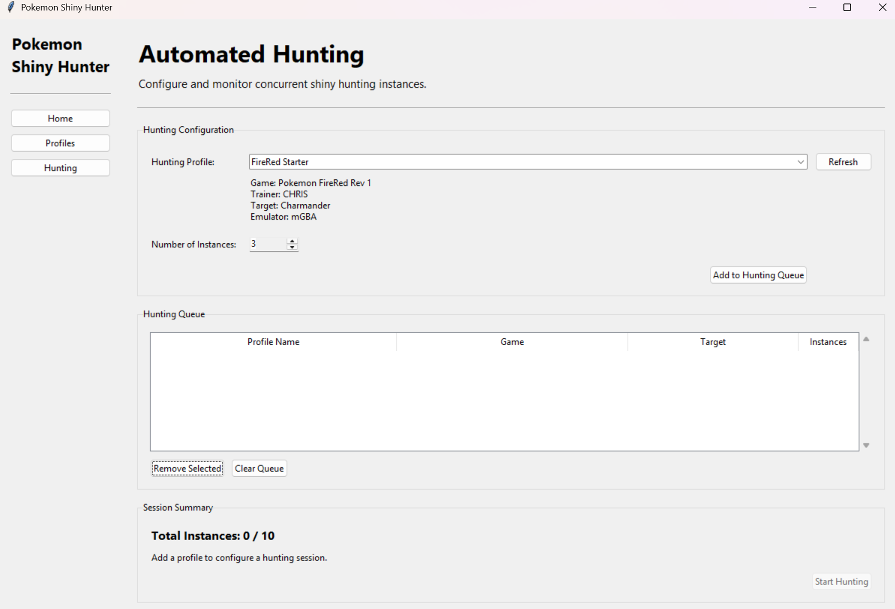
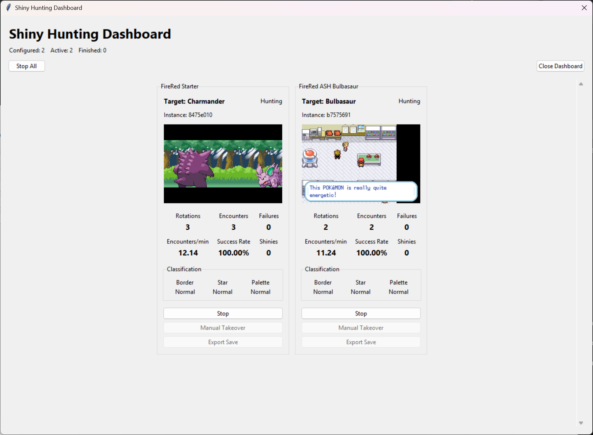

# Live Hunting Dashboard

## Overview

The hunting dashboard provides a graphical interface for configuring,
executing, and monitoring multiple automated shiny hunting instances.
Each instance operates independently using a background worker,
allowing emulator execution to continue without blocking the graphical
user interface.

The dashboard supports multiple instances of the same profile as well
as instances using different profiles within a single hunting session.

## Hunting Configuration

Users select an existing permanent hunting profile and specify the
number of instances to create. Multiple profiles can be added to the
hunting queue before beginning a session.

The application currently permits a maximum of ten configured instances.
This is a configuration limit rather than a verified performance limit.

Each instance receives an independent temporary ROM and save copy.
The original permanent profiles remain unchanged throughout hunting.

*Hunting configuration containing multiple profiles.*

*Removal of a selected profile from the hunting queue.*

## Concurrent Hunting Architecture

Each hunting instance is managed by a HuntingWorker operating in a
separate background thread. The worker initializes its own emulator
instance and hunting controller.

The hunting controller continuously executes the configured macro,
validates the resulting summary screen, and performs shiny
classification.

Communication between the hunting workers and the graphical interface
is performed using thread-safe event queues and independent
framebuffer storage.

All graphical interface updates occur on the main application thread.
The interface does not directly access native emulator resources while
a hunting worker is running.

## Individual Instance Panels

Each instance panel displays the following information:

- Profile name
- Target Pokemon
- Unique instance identifier
- Current hunting state
- Emulator framebuffer
- Completed rotations
- Valid encounters
- Failed rotations
- Encounter success rate
- Encounters per minute
- Number of detected shinies
- Individual classifier predictions

Each instance also provides independent stopping functionality.
Manual takeover and save export controls are reserved for successful
shiny encounters.

## Responsive Dashboard Layout

The dashboard arranges instance panels according to the available
horizontal space.

Initial testing revealed that fixed column-width assumptions caused
panel compression, clipped contents, and disappearing panels during
window resizing.

The layout was corrected by measuring the actual requested width of
each panel and calculating the number of columns that can fit within
the available display area.

Panels retain their required dimensions and are centered horizontally.
Vertical scrolling provides access to instances that cannot fit within
the visible window.

*Vertical panel arrangement within a narrow dashboard window.*

*Horizontal panel arrangement within a wider dashboard window.*

## Concurrent Hunting Verification

Two independent instances were configured using the FireRed Starter
and FireRed ASH Bulbasaur profiles.

The experiment verified concurrent macro execution, independent
classification, individual stopping, global stopping, and final
statistics preservation.

| Measurement | Charmander | Bulbasaur |
|---|---:|---:|
| Completed rotations | 9 | 11 |
| Valid encounters | 9 | 11 |
| Failed rotations | 0 | 0 |
| Success rate | 100% | 100% |
| Encounters per minute | 10.48 | 10.25 |
| Execution time | 51.53 s | 64.39 s |
| Final state | Stopped | Stopped |

All twenty rotations completed successfully.

Stopping the Charmander instance did not interrupt the Bulbasaur
instance. Both emulator instances were subsequently closed, and the
application terminated with exit code zero.

*Independent hunting instances operating concurrently.*

*One hunting instance stopped while another remains active.*

*Final encounter screenshots and statistics following termination.*

## Rotation Event Communication

The hunting controller publishes an event following every completed
rotation.

Each rotation event contains:

- Unique instance identifier
- Rotation statistics
- Classification results
- Captured screenshot path

Statistics and classification results are provided as independent
snapshots rather than references to mutable counters.

The hunting worker publishes initialization, rotation, completion,
and error events through a thread-safe queue.

The graphical interface processes these events without interrupting
ongoing emulator execution.

### Rotation Event Verification

Two concurrent workers were configured to execute three rotations
each.

| Measurement | Charmander | Bulbasaur |
|---|---:|---:|
| Completed rotations | 3 | 3 |
| Rotation events | 3 | 3 |
| Valid encounters | 3 | 3 |
| Failed rotations | 0 | 0 |
| Encounters per minute | 12.78 | 12.01 |
| Execution time | 14.09 s | 14.98 s |

The combined execution time was 15.0450 seconds.

All six rotation events were delivered in the expected order.
Progressive statistics, independent event snapshots, screenshot
ownership, and final statistics consistency were verified.

Both permanent profiles remained unchanged.

## Live Framebuffer Capture

The emulator macro supports an optional framebuffer callback that
is executed following each emulated frame.

The worker uses elapsed real-world time to determine whether a new
framebuffer image should be captured. The current configuration
limits framebuffer capture to ten frames per second per instance.

This capture limit does not restrict the emulator's execution speed.

Framebuffer images are converted to RGB and copied within the owning
worker thread. This prevents the graphical interface from accessing
native framebuffer memory while the emulator is actively modifying it.

Each worker retains only its latest captured image. New images replace
previous images rather than accumulating in a queue.

A sequence number identifies each captured image, allowing the
graphical interface to avoid retrieving the same image repeatedly.

This design bounds framebuffer storage independently of hunting
session duration.

### Framebuffer Capture Verification

Two concurrent hunting workers were configured to execute three
rotations with framebuffer capture enabled.

| Measurement | Charmander | Bulbasaur |
|---|---:|---:|
| Completed rotations | 3 | 3 |
| Valid encounters | 3 | 3 |
| Failed rotations | 0 | 0 |
| Target capture FPS | 10 | 10 |
| Measured capture FPS | 9.9691 | 9.9661 |
| Captured frames | 156 | 164 |
| Received frames | 156 | 164 |
| Changed frame observations | 106 | 112 |
| Average capture time | 0.0543 ms | 0.0508 ms |

The combined execution time was 16.3973 seconds.

All 320 captured frames were retrieved during the experiment.
Framebuffer dimensions remained at the native Game Boy Advance
resolution of 240 by 160 pixels.

Independent framebuffer copies, duplicate frame suppression,
capture throttling, and progressive image updates were verified.

Temporary emulator resources and stored framebuffer images were
released following completion. Both permanent profiles remained
unchanged.

## Live Dashboard Integration

The graphical interface polls each worker at an interval of
100 milliseconds.

During each polling operation, the interface processes available
rotation events and retrieves the latest framebuffer when its
sequence number has changed.

Statistics and classifier predictions are updated after each
completed rotation. Framebuffer updates occur independently of
rotation completion.

When a worker terminates, its final classified screenshot takes
precedence over previously sampled framebuffer images.

This prevents older images from replacing the final encounter
display.

*Concurrent hunting with live gameplay and progressive statistics.*

*Responsive dashboard arrangement during active hunting.*

*Preserved final encounter alongside an active hunting instance.*

*Final framebuffer images, classifications, and statistics.*

### Integrated Dashboard Verification

Two independent profiles were hunted concurrently through the
graphical interface.

| Measurement | Charmander | Bulbasaur |
|---|---:|---:|
| Completed rotations | 11 | 7 |
| Valid encounters | 11 | 7 |
| Failed rotations | 0 | 0 |
| Success rate | 100% | 100% |
| Encounters per minute | 12.17 | 10.43 |
| Execution time | 54.24 s | 40.27 s |
| Captured frames | 541 | 402 |
| Measured capture FPS | 9.9710 | 9.9682 |
| Total capture time | 0.029826 s | 0.020957 s |
| Final state | Stopped | Stopped |

All eighteen rotations completed successfully, and a combined total
of 943 framebuffer images were captured.

The Bulbasaur instance was stopped independently while Charmander
continued hunting.

The stopped instance retained its final encounter screenshot and
statistics while the remaining instance continued receiving updates.

Both instances were subsequently closed, and the application
terminated with exit code zero.

## Controlled Framebuffer Performance Evaluation

A controlled experiment was conducted to measure the execution
overhead associated with framebuffer capture and retrieval.

Three configurations were evaluated:

- Baseline with framebuffer capture disabled.
- Framebuffer capture enabled at ten frames per second.
- Framebuffer capture and periodic image retrieval enabled.

Each configuration executed twenty rotations using the same
Charmander hunting profile.

The Python random generator was initialized with a seed of 604
before each experiment. The recorded macro schedules were identical
across the three configurations.

Only one hunting instance was executed at a time to prevent
concurrent macro execution from affecting the randomized schedules.

The retrieval configuration requested new framebuffer images at
approximately 100-millisecond intervals, representing the polling
frequency used by the graphical interface.

### Performance Results

| Measurement | Baseline | Capture Only | Capture and Retrieval |
|---|---:|---:|---:|
| Completed rotations | 20 | 20 | 20 |
| Valid encounters | 20 | 20 | 20 |
| Failed rotations | 0 | 0 | 0 |
| Success rate | 100% | 100% | 100% |
| Execution time (s) | 105.4816 | 104.7230 | 107.2663 |
| Encounters per minute | 11.38 | 11.46 | 11.19 |
| Observed overhead | 0.00% | -0.72% | 1.69% |
| Captured frames | 0 | 1044 | 1070 |
| Retrieved frames | 0 | 0 | 1067 |
| Capture FPS | N/A | 9.9670 | 9.9696 |
| Average capture time (ms) | N/A | 0.0550 | 0.0566 |
| Total capture time (s) | 0 | 0.057422 | 0.060590 |
| Total retrieval time (s) | 0 | 0 | 0.020569 |

Observed execution overhead was calculated relative to the
baseline configuration:

    Overhead (%) = ((Experimental Time - Baseline Time)
                    / Baseline Time) * 100

All sixty rotations completed successfully without invalid
summary screens or failed rotations.

The capture-only configuration completed slightly faster than
the baseline. This difference may be attributed to ordinary
execution variability rather than an improvement caused by
framebuffer capture.

The capture and retrieval configuration required approximately
1.78 additional seconds across twenty rotations, representing
an observed execution overhead of 1.69%.

A total of 1067 out of 1070 captured images were retrieved,
representing a retrieval rate of approximately 99.72%.

These results support retaining the ten-frame-per-second capture
configuration for the current implementation.

## Experimental Limitations

The controlled performance evaluation was conducted using a
single hunting instance, with one experimental run per
configuration.

Although identical macro schedules were used, operating system
scheduling and other execution variability were not eliminated.

Framebuffer retrieval simulated the polling frequency of the
graphical interface but did not include actual Tkinter image
rendering. The measured overhead therefore does not represent
the complete graphical rendering cost.

The measured framebuffer capture rate also does not guarantee
an equivalent graphical rendering rate. Intermediate images may
be skipped when the interface cannot retrieve them in time.

The repeated seeded macro schedules should not be considered
independent randomized samples for evaluating classifier accuracy.

The dashboard has been experimentally verified using two
concurrent hunting instances. Performance at the configured
maximum of ten instances has not yet been evaluated.

Classifier predictions represent the most recently completed
rotation rather than the currently displayed gameplay frame.

Stop requests are processed at rotation boundaries rather than
immediately interrupting macro execution.

The dashboard experiments described in this document produced
normal encounters. Shiny-positive notification and graphical
manual takeover behavior require separate controlled verification.

## Conclusion

The hunting dashboard successfully integrates concurrent emulator
execution, progressive encounter statistics, computer vision
classification, and live framebuffer updates within a graphical
desktop application.

Independent hunting workers allow users to monitor and stop
individual instances without interrupting other active hunts.

Experimental results demonstrate successful concurrent execution,
responsive panel arrangement, reliable event delivery, and
framebuffer capture close to the configured ten-frame-per-second
target.

The controlled performance evaluation observed a relatively small
execution-time difference when framebuffer capture and retrieval
were enabled, supporting their continued use in the application.