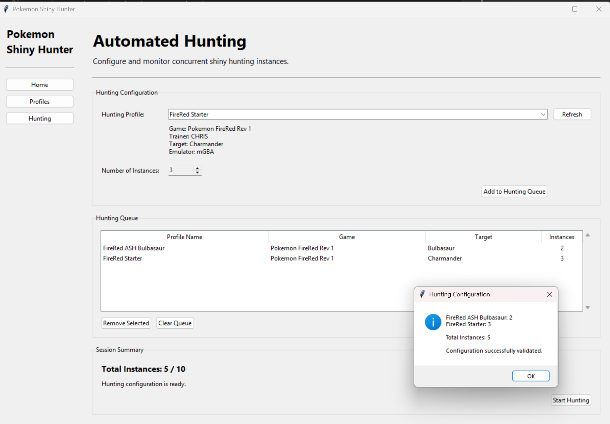
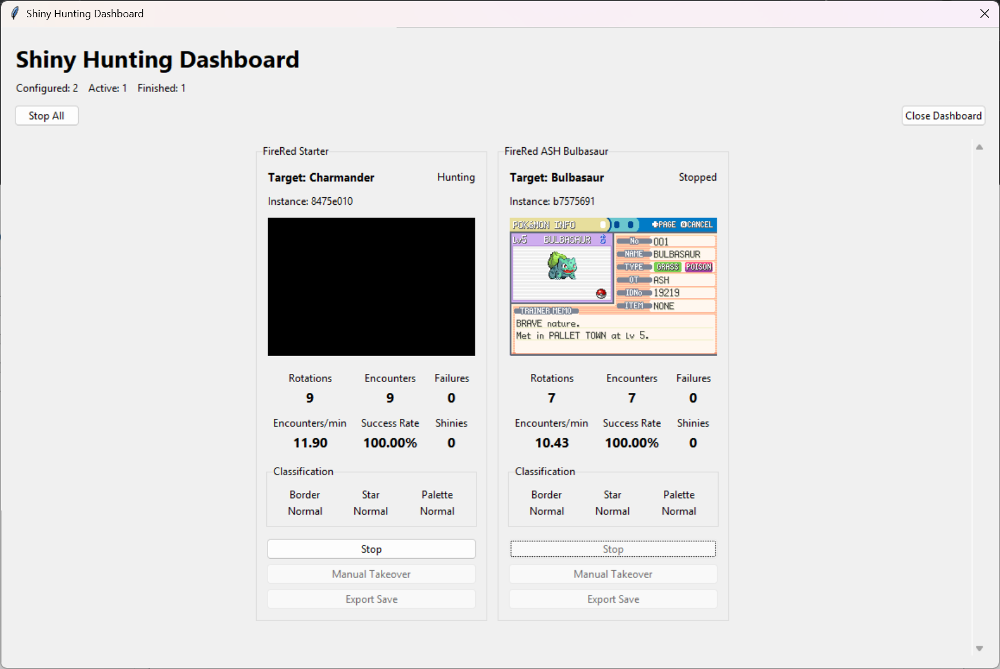
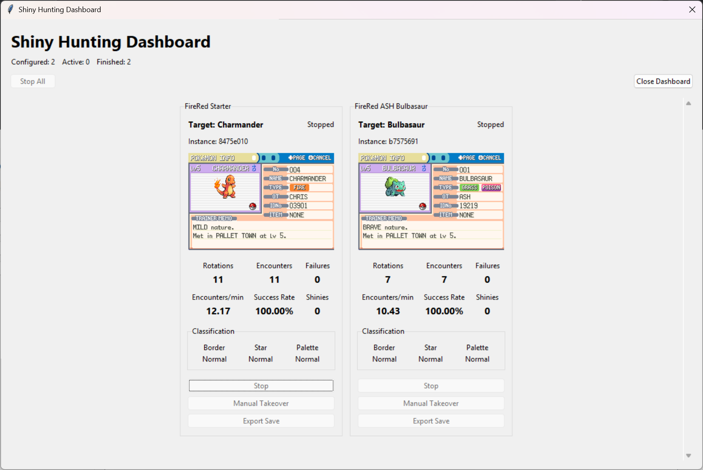
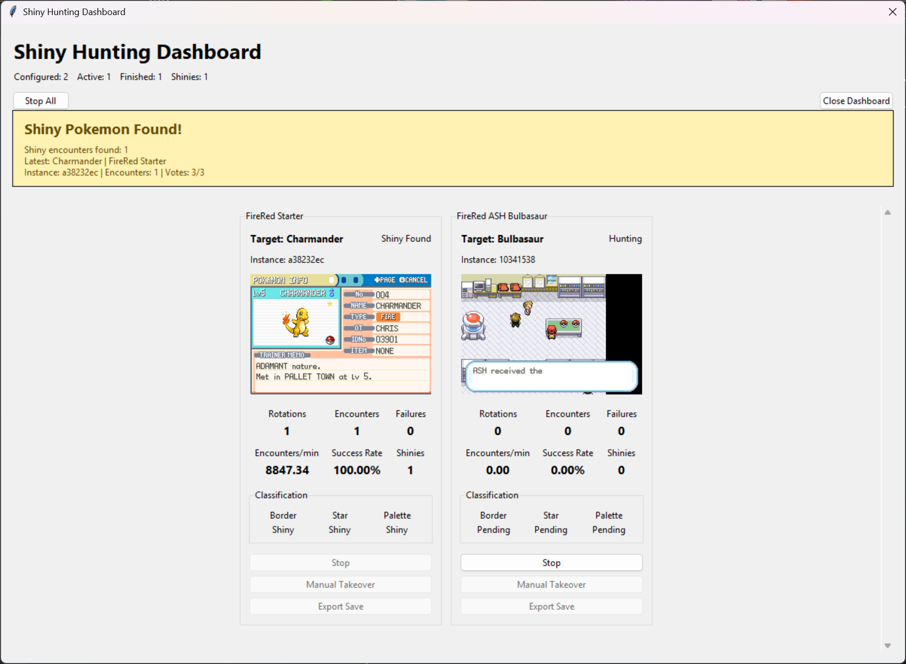
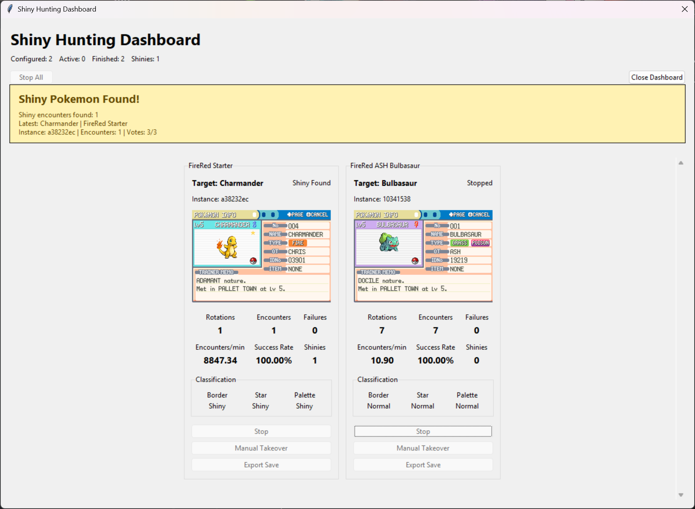
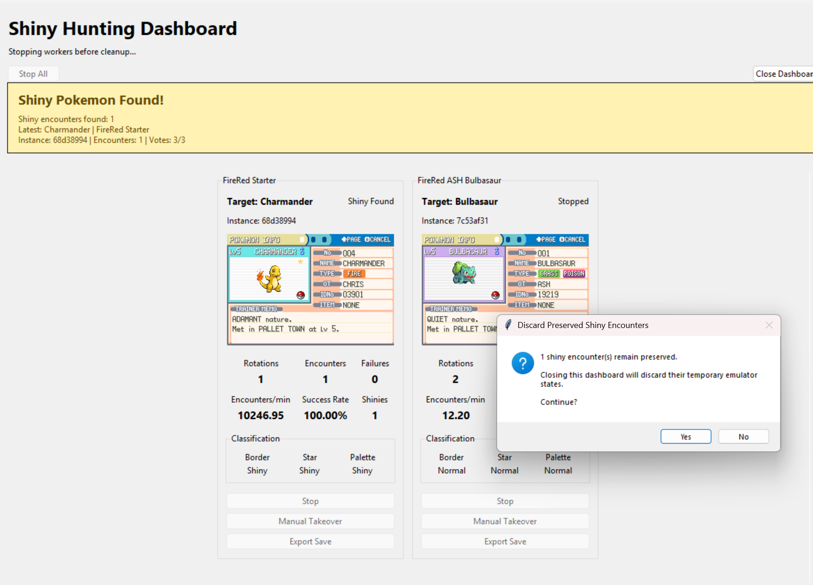

# Live Hunting Dashboard

## Overview

The hunting dashboard provides a graphical interface for configuring,
executing, and monitoring multiple automated shiny hunting instances.
Each instance operates independently using a background worker,
allowing emulator execution to continue without blocking the graphical
user interface.

The dashboard supports multiple instances of the same profile as well
as instances using different profiles within a single hunting session.

Successful shiny encounters are automatically preserved, allowing the
user to assume manual control of the emulator and export the resulting
game save.

## Hunting Configuration

Users select an existing permanent hunting profile and specify the
number of instances to create. Multiple profiles can be added to the
hunting queue before beginning a session.

The application currently permits a maximum of ten configured instances.
This is a configuration limit rather than a verified performance limit.

Each instance receives an independent temporary ROM and save copy.
The original permanent profiles remain unchanged throughout hunting.

*Hunting configuration containing multiple profiles.*

*Removal of a selected profile from the hunting queue.*

## Concurrent Hunting Architecture

Each hunting instance is managed by a HuntingWorker operating in a
separate background thread. The worker initializes its own emulator
instance and hunting controller.

The hunting controller continuously executes the configured macro,
validates the resulting summary screen, and performs shiny
classification.

Communication between the hunting workers and the graphical interface
is performed using thread-safe event queues and independent
framebuffer storage.

All graphical interface updates occur on the main application thread.
The interface does not directly access native emulator resources while
a hunting worker is running.

## Individual Instance Panels

Each instance panel displays the following information:

- Profile name
- Target Pokemon
- Unique instance identifier
- Current hunting state
- Emulator framebuffer
- Completed rotations
- Valid encounters
- Failed rotations
- Encounter success rate
- Encounters per minute
- Number of detected shinies
- Individual classifier predictions

Each instance also provides independent stopping functionality.
Manual takeover and save export controls become available at the
appropriate stages following successful shiny detection.

## Responsive Dashboard Layout

The dashboard arranges instance panels according to the available
horizontal space.

Initial testing revealed that fixed column-width assumptions caused
panel compression, clipped contents, and disappearing panels during
window resizing.

The layout was corrected by measuring the actual requested width of
each panel and calculating the number of columns that can fit within
the available display area.

Panels retain their required dimensions and are centered horizontally.
Vertical scrolling provides access to instances that cannot fit within
the visible window.

*Vertical panel arrangement within a narrow dashboard window.*

*Horizontal panel arrangement within a wider dashboard window.*

## Concurrent Hunting Verification

Two independent instances were configured using the FireRed Starter
and FireRed ASH Bulbasaur profiles.

The experiment verified concurrent macro execution, independent
classification, individual stopping, global stopping, and final
statistics preservation.

| Measurement | Charmander | Bulbasaur |
|---|---:|---:|
| Completed rotations | 9 | 11 |
| Valid encounters | 9 | 11 |
| Failed rotations | 0 | 0 |
| Success rate | 100% | 100% |
| Encounters per minute | 10.48 | 10.25 |
| Execution time | 51.53 s | 64.39 s |
| Final state | Stopped | Stopped |

All twenty rotations completed successfully.

Stopping the Charmander instance did not interrupt the Bulbasaur
instance. Both emulator instances were subsequently closed, and the
application terminated with exit code zero.

*Independent hunting instances operating concurrently.*

*One hunting instance stopped while another remains active.*

*Final encounter screenshots and statistics following termination.*

## Rotation Event Communication

The hunting controller publishes an event following every completed
rotation.

Each rotation event contains:

- Unique instance identifier
- Rotation statistics
- Classification results
- Captured screenshot path

Statistics and classification results are provided as independent
snapshots rather than references to mutable counters.

The hunting worker publishes initialization, rotation, completion,
and error events through a thread-safe queue.

The graphical interface processes these events without interrupting
ongoing emulator execution.

### Rotation Event Verification

Two concurrent workers were configured to execute three rotations
each.

| Measurement | Charmander | Bulbasaur |
|---|---:|---:|
| Completed rotations | 3 | 3 |
| Rotation events | 3 | 3 |
| Valid encounters | 3 | 3 |
| Failed rotations | 0 | 0 |
| Encounters per minute | 12.78 | 12.01 |
| Execution time | 14.09 s | 14.98 s |

The combined execution time was 15.0450 seconds.

All six rotation events were delivered in the expected order.
Progressive statistics, independent event snapshots, screenshot
ownership, and final statistics consistency were verified.

Both permanent profiles remained unchanged.

## Live Framebuffer Capture

The emulator macro supports an optional framebuffer callback that
is executed following each emulated frame.

The worker uses elapsed real-world time to determine whether a new
framebuffer image should be captured. The current configuration
limits framebuffer capture to ten frames per second per instance.

This capture limit does not restrict the emulator's execution speed.

Framebuffer images are converted to RGB and copied within the owning
worker thread. This prevents the graphical interface from accessing
native framebuffer memory while the emulator is actively modifying it.

Each worker retains only its latest captured image. New images replace
previous images rather than accumulating in a queue.

A sequence number identifies each captured image, allowing the
graphical interface to avoid retrieving the same image repeatedly.

This design bounds framebuffer storage independently of hunting
session duration.

### Framebuffer Capture Verification

Two concurrent hunting workers were configured to execute three
rotations with framebuffer capture enabled.

| Measurement | Charmander | Bulbasaur |
|---|---:|---:|
| Completed rotations | 3 | 3 |
| Valid encounters | 3 | 3 |
| Failed rotations | 0 | 0 |
| Target capture FPS | 10 | 10 |
| Measured capture FPS | 9.9691 | 9.9661 |
| Captured frames | 156 | 164 |
| Received frames | 156 | 164 |
| Changed frame observations | 106 | 112 |
| Average capture time | 0.0543 ms | 0.0508 ms |

The combined execution time was 16.3973 seconds.

All 320 captured frames were retrieved during the experiment.
Framebuffer dimensions remained at the native Game Boy Advance
resolution of 240 by 160 pixels.

Independent framebuffer copies, duplicate frame suppression,
capture throttling, and progressive image updates were verified.

Temporary emulator resources and stored framebuffer images were
released following completion. Both permanent profiles remained
unchanged.

## Live Dashboard Integration

The graphical interface polls each worker at an interval of
100 milliseconds.

During each polling operation, the interface processes available
rotation events and retrieves the latest framebuffer when its
sequence number has changed.

Statistics and classifier predictions are updated after each
completed rotation. Framebuffer updates occur independently of
rotation completion.

When a worker terminates, its final classified screenshot takes
precedence over previously sampled framebuffer images.

This prevents older images from replacing the final encounter
display.

*Concurrent hunting with live gameplay and progressive statistics.*

*Responsive dashboard arrangement during active hunting.*

*Preserved final encounter alongside an active hunting instance.*

*Final framebuffer images, classifications, and statistics.*

### Integrated Dashboard Verification

Two independent profiles were hunted concurrently through the
graphical interface.

| Measurement | Charmander | Bulbasaur |
|---|---:|---:|
| Completed rotations | 11 | 7 |
| Valid encounters | 11 | 7 |
| Failed rotations | 0 | 0 |
| Success rate | 100% | 100% |
| Encounters per minute | 12.17 | 10.43 |
| Execution time | 54.24 s | 40.27 s |
| Captured frames | 541 | 402 |
| Measured capture FPS | 9.9710 | 9.9682 |
| Total capture time | 0.029826 s | 0.020957 s |
| Final state | Stopped | Stopped |

All eighteen rotations completed successfully, and a combined total
of 943 framebuffer images were captured.

The Bulbasaur instance was stopped independently while Charmander
continued hunting.

The stopped instance retained its final encounter screenshot and
statistics while the remaining instance continued receiving updates.

Both instances were subsequently closed, and the application
terminated with exit code zero.

## Controlled Framebuffer Performance Evaluation

A controlled experiment was conducted to measure the execution
overhead associated with framebuffer capture and retrieval.

Three configurations were evaluated:

- Baseline with framebuffer capture disabled.
- Framebuffer capture enabled at ten frames per second.
- Framebuffer capture and periodic image retrieval enabled.

Each configuration executed twenty rotations using the same
Charmander hunting profile.

The Python random generator was initialized with a seed of 604
before each experiment. The recorded macro schedules were identical
across the three configurations.

Only one hunting instance was executed at a time to prevent
concurrent macro execution from affecting the randomized schedules.

The retrieval configuration requested new framebuffer images at
approximately 100-millisecond intervals, representing the polling
frequency used by the graphical interface.

### Performance Results

| Measurement | Baseline | Capture Only | Capture and Retrieval |
|---|---:|---:|---:|
| Completed rotations | 20 | 20 | 20 |
| Valid encounters | 20 | 20 | 20 |
| Failed rotations | 0 | 0 | 0 |
| Success rate | 100% | 100% | 100% |
| Execution time (s) | 105.4816 | 104.7230 | 107.2663 |
| Encounters per minute | 11.38 | 11.46 | 11.19 |
| Observed overhead | 0.00% | -0.72% | 1.69% |
| Captured frames | 0 | 1044 | 1070 |
| Retrieved frames | 0 | 0 | 1067 |
| Capture FPS | N/A | 9.9670 | 9.9696 |
| Average capture time (ms) | N/A | 0.0550 | 0.0566 |
| Total capture time (s) | 0 | 0.057422 | 0.060590 |
| Total retrieval time (s) | 0 | 0 | 0.020569 |

Observed execution overhead was calculated relative to the
baseline configuration:

    Overhead (%) = ((Experimental Time - Baseline Time)
                    / Baseline Time) * 100

All sixty rotations completed successfully without invalid
summary screens or failed rotations.

The capture-only configuration completed slightly faster than
the baseline. This difference may be attributed to ordinary
execution variability rather than an improvement caused by
framebuffer capture.

The capture and retrieval configuration required approximately
1.78 additional seconds across twenty rotations, representing
an observed execution overhead of 1.69%.

A total of 1067 out of 1070 captured images were retrieved,
representing a retrieval rate of approximately 99.72%.

These results support retaining the ten-frame-per-second capture
configuration for the current implementation.

## Concurrent Hunting Scalability

The hunting dashboard was tested using ten concurrent emulator
instances, consisting of five Bulbasaur instances and five
Charmander instances. Both profiles operated independently
throughout the hunting session.

| Measurement | Bulbasaur | Charmander | Total |
|---|---:|---:|---:|
| Instances | 5 | 5 | 10 |
| Completed rotations | 155 | 158 | 313 |
| Valid encounters | 155 | 158 | 313 |
| Failed rotations | 0 | 0 | 0 |
| Success rate | 100% | 100% | 100% |
| Encounters per minute | 38.56 | 39.51 | 78.07 |

The combined encounter rate represents the sum of the displayed
individual instance rates.

All ten instances were successfully stopped using the global
stopping control. Each instance retained its final encounter
image and statistics.

*Final encounter images and statistics for ten concurrent instances.*

### Framebuffer Performance

Framebuffer capture statistics were collected from one Bulbasaur
instance during the ten-instance experiment.

| Measurement | Result |
|---|---:|
| Execution time | 242.89 seconds |
| Captured frames | 2,418 |
| Target capture FPS | 10 |
| Measured capture FPS | 9.9549 |
| Total capture time | 0.181685 seconds |
| Average capture time | 0.0751 ms |

The sampled instance maintained approximately 10 FPS while
operating alongside nine additional emulator instances.

During an earlier observation of the same session, Python
consumed approximately 372.6 MB of memory. This measurement
represents an individual observation rather than average or
maximum memory consumption.

### Encounter Variation

Captured encounter screenshots demonstrated variation in Pokemon
natures across successive rotations. This indicates that the
randomized macro timing did not repeatedly produce the same
encounter characteristics.

*Variation in Pokemon natures across successive encounters.*

Although encounter variation was observed, this does not
establish statistical independence between successive encounters.

### Screenshot Retention

The original implementation generated a separate screenshot
after each completed rotation. This resulted in unnecessary
file accumulation during extended hunting sessions.

The screenshot destination was changed to `encounter.png`
within each instance's picture directory. Each subsequent
rotation overwrites the previous encounter image.

This preserves the existing screenshot-based classification
process while limiting each hunting instance to one encounter
image. Successful shiny encounters retain their screenshots
because the corresponding hunting instance stops automatically.

## Shiny Encounter Notifications

The dashboard provides a persistent graphical notification
and an audible system alert when a shiny Pokemon is detected.

The notification identifies the Pokemon, associated profile,
instance identifier, encounter count, and classification votes.

A controlled experiment was conducted using an existing shiny
Charmander save alongside a normally hunting Bulbasaur instance.
The actual Charmander summary screen was evaluated using the
existing computer vision pipeline without overriding the
classifier predictions.

*Persistent notification following successful shiny classification.*

All three classification methods identified Charmander as
shiny. The corresponding hunting instance stopped automatically
while Bulbasaur continued hunting.

| Measurement | Charmander | Bulbasaur |
|---|---:|---:|
| Completed rotations | 1 | 7 |
| Valid encounters | 1 | 7 |
| Failed rotations | 0 | 0 |
| Shinies detected | 1 | 0 |
| Final state | Shiny Found | Stopped |

*The shiny encounter remains preserved while the other instance
continues hunting.*

The notification remained visible after the remaining hunting
instance was stopped. A standard Windows notification sound
was also observed during testing.

### Shiny Encounter Protection

A subsequent controlled test demonstrated the confirmation
warning presented when closing a dashboard containing an
unexported shiny encounter.

*Confirmation warning before discarding a preserved shiny encounter.*

The warning informs the user that closing the dashboard will
discard the temporary emulator state containing the shiny
Pokemon.

Successfully exported encounters are excluded from this warning.

## Graphical Manual Takeover

Following successful shiny detection, the hunting worker stops
without closing or resetting the original emulator instance.

The Manual Takeover control becomes available after the worker
has finished execution. The user can then assume control of
the preserved emulator through a separate graphical window.

The manual takeover window uses the existing emulator view
and keyboard controls provided during manual profile preparation.

Emulator execution resumes at the game's normal speed rather
than the accelerated speed used during automated hunting.

*Manual control of the original emulator containing a preserved
shiny Charmander.*

The user can navigate the game normally, exit the Pokemon
summary screen, and save progress using the game's internal
saving functionality.

Finishing manual takeover does not automatically save the game.
A confirmation prompt reminds the user to save before returning
to the hunting dashboard.

*Confirmation prompt reminding the user to save progress in-game.*

After manual takeover finishes, the dashboard displays the
final gameplay framebuffer and changes the instance status
to Ready to Export.

The user can resume manual gameplay before exporting, provided
that the original emulator core remains available.

## Graphical Save Export

The Export Save control becomes available after manual
takeover has finished.

A file selection dialog allows the user to choose the destination
and filename of the exported battery save.

The default destination is the application's exports directory.
The suggested filename contains the permanent profile name
and unique temporary instance identifier.

*Selection of the destination for the exported Game Boy Advance save.*

The export operation uses the existing battery save export
functionality. The original emulator core is released before
the temporary battery save is copied to its destination.

The exported save is validated without modifying the original
permanent hunting profile.

Following successful export, the instance status changes to
Save Exported. Manual takeover and save export controls are
disabled for that instance.

*Successful save export confirmation and final dashboard state.*

The shiny notification and final classification results remain
visible after export.

The exported file is stored independently of the temporary
emulator resources and is retained when the dashboard closes.

## Integrated Shiny Workflow Verification

A controlled experiment was conducted to verify the complete
graphical workflow following successful shiny detection.

The experiment used an existing shiny Charmander save and a
normally hunting Bulbasaur instance.

The Charmander instance was manually positioned at its shiny
summary screen during test preparation. A capture-only macro
was used to evaluate the actual emulator framebuffer without
generating another encounter.

The Bulbasaur instance continued using the normal randomized
FireRed hunting macro.

### Experimental Results

| Measurement | Charmander | Bulbasaur |
|---|---:|---:|
| Instance identifier | 37dfcbf0 | 6d4fc5cb |
| Completed rotations | 1 | 3 |
| Valid encounters | 1 | 3 |
| Failed rotations | 0 | 0 |
| Success rate | 100% | 100% |
| Shinies detected | 1 | 0 |
| Shiny classification votes | 3/3 | 0/3 |
| Hunting execution time | 0.01 s | 16.32 s |
| Encounters per minute | N/A | 11.03 |
| Captured frames | 1 | 163 |
| Measured capture FPS | N/A | 9.9703 |
| Total capture time | 0.000070 s | 0.008383 s |
| Final controller state | Shiny Found | Stopped |
| Final dashboard status | Save Exported | Stopped |

The Charmander instance stopped automatically following
successful classification. The Bulbasaur instance completed
three valid encounters after the shiny notification was
delivered.

The original Charmander emulator core and framebuffer were
preserved, allowing manual gameplay to resume without
recreating the emulator or resetting the game.

Manual gameplay, the in-game save confirmation prompt, and
the graphical save export operation were successfully exercised.

The resulting battery save was exported as:

    exports/FireRed Starter_37dfcbf0.sav

The exported file contained 131,072 bytes, matching the
expected FireRed battery save size.

### Functional Verification

| Verification | Result |
|---|---|
| Actual shiny summary classification | PASS |
| Automatic shiny worker termination | PASS |
| Original emulator core preservation | PASS |
| Original framebuffer preservation | PASS |
| Shiny screenshot preservation | PASS |
| Duplicate notification prevention | PASS |
| Continued independent hunting | PASS |
| Graphical manual takeover | PASS |
| Manual gameplay controls | PASS |
| In-game save confirmation prompt | PASS |
| Graphical export dialog | PASS |
| Successful battery save export | PASS |
| Expected exported save size | PASS |
| Exported save retained after closure | PASS |
| Closure without unnecessary discard warning | PASS |
| Temporary instance cleanup | PASS |
| Permanent Charmander profile unchanged | PASS |
| Permanent Bulbasaur profile unchanged | PASS |
| Controlled source save unchanged | PASS |

Both emulator instances were successfully closed following
the experiment.

The dashboard closed without presenting a discard warning
for the successfully exported shiny encounter.

The exported save remained available in the exports directory
following temporary instance cleanup.

The automated shiny notification verification completed
successfully, and the process terminated with exit code zero.

## Experimental Limitations

The controlled framebuffer performance evaluation was conducted
using a single hunting instance, with one experimental run per
configuration.

Although identical macro schedules were used, operating system
scheduling and other execution variability were not eliminated.

Framebuffer retrieval simulated the polling frequency of the
graphical interface but did not include actual Tkinter image
rendering. The measured overhead therefore does not represent
the complete graphical rendering cost.

The measured framebuffer capture rate also does not guarantee
an equivalent graphical rendering rate. Intermediate images may
be skipped when the interface cannot retrieve them in time.

The repeated seeded macro schedules should not be considered
independent randomized samples for evaluating classifier accuracy.

The dashboard has been experimentally verified using up to ten
concurrent hunting instances. Configurations exceeding ten
instances have not been evaluated.

Framebuffer performance during ten-instance operation was
measured for one instance. The recorded memory consumption
represents an individual observation rather than a measurement
throughout the entire hunting session.

Classifier predictions represent the most recently completed
rotation rather than the currently displayed gameplay frame.

Stop requests are processed at rotation boundaries rather than
immediately interrupting macro execution.

The controlled shiny experiments used an existing shiny save
rather than a naturally generated shiny encounter. The normal
encounter-generation macro was bypassed for Charmander, so its
displayed encounter rate is excluded from hunting performance
results.

Successful export confirms that a battery save was created at
the selected destination with the expected file size. The
specific save produced during the graphical integration test
was not independently reloaded during that experiment.

Battery save reloading was previously verified during backend
manual takeover and save export testing.

The application relies on the user to save progress in-game
before completing manual takeover. The confirmation prompt
does not independently verify that the user has saved the
shiny Pokemon.

Repeated manual takeover, export cancellation, and graphical
export failure recovery were not independently recorded during
the integrated shiny workflow experiment.

## Conclusion

The hunting dashboard successfully integrates concurrent emulator
execution, progressive encounter statistics, computer vision
classification, and live framebuffer updates within a graphical
desktop application.

Independent hunting workers allow users to monitor and stop
individual instances without interrupting other active hunts.

Experimental results demonstrate successful concurrent execution,
responsive panel arrangement, reliable event delivery, and
framebuffer capture close to the configured ten-frame-per-second
target.

The controlled performance evaluation observed a relatively small
execution-time difference when framebuffer capture and retrieval
were enabled, supporting their continued use in the application.

Testing with ten concurrent emulator instances produced 313 valid
encounters without failed rotations. The combined displayed
encounter rate was 78.07 encounters per minute.

Controlled shiny testing demonstrated successful classification,
automatic hunting termination, persistent notifications, emulator
preservation, graphical manual takeover, and battery save export.

The integrated workflow allows users to recover a detected shiny
encounter without manually interacting with temporary emulator
files or modifying permanent hunting profiles.

## Safe Application Shutdown

Application shutdown coordination was implemented to prevent
the main application from terminating while temporary emulator
resources remain active.

The application checks for active preparation windows and
hunting dashboards before completing shutdown.

When closing an active hunting dashboard, the user is prompted
to confirm termination of the remaining hunting instances.

If the user declines, the dashboard remains open and hunting
continues normally.

If the user accepts, all active workers receive a stop request.
Each worker completes its current rotation before terminating.

The dashboard waits for all workers to terminate before closing
their emulator instances and removing temporary instance
directories.

Permanent hunting profiles and exported battery saves are
not removed during cleanup.

### Shutdown Verification

Shutdown behavior was evaluated using manual profile preparation
and a hunting session containing ten concurrent instances.

The hunting session consisted of five Bulbasaur instances and
five Charmander instances.

| Measurement | Bulbasaur | Charmander | Total |
|---|---:|---:|---:|
| Instances | 5 | 5 | 10 |
| Completed rotations | 14 | 15 | 29 |
| Valid encounters | 14 | 15 | 29 |
| Failed rotations | 0 | 0 | 0 |
| Instances stopped | 5 | 5 | 10 |
| Instances closed | 5 | 5 | 10 |

*Concurrent hunting workers completing their current rotations
before temporary instance cleanup.*

All ten emulator instances were successfully stopped and closed.
The temporary directories created during the hunting session
were removed.

Existing temporary directories unrelated to the current session
remained unchanged.

| Verification | Result |
|---|---|
| Manual preparation cancellation | PASS |
| Temporary preparation cleanup | PASS |
| Declined shutdown confirmation | PASS |
| Continued hunting after declined shutdown | PASS |
| Dashboard closure during active hunting | PASS |
| Concurrent worker termination | PASS |
| Emulator resource cleanup | PASS |
| Temporary hunting directory cleanup | PASS |
| Application exit code zero | PASS |

The preparation window and hunting dashboard retain their
modal behavior. Users must close the active child window
before interacting with the main application.

Direct main application shutdown while a modal child window
is active was therefore not independently verified.

## Final FireRed Integration Verification

A final integration test was conducted through the main
application to verify profile creation, persistence,
concurrent hunting, and resource cleanup.

A new Squirtle profile was created from scratch using the
integrated manual gameplay interface.

The game introduction was completed manually, and an in-game
save was created before finalizing the permanent hunting
profile.

The application was subsequently closed and restarted to
verify that the newly created profile remained available.

A hunting session containing six concurrent instances was
then initiated using the available FireRed profiles.

Six independent temporary instance directories were created
during initialization.

The global stopping control was used to terminate the hunting
session before closing the dashboard.

All six temporary instance directories were removed, while
the existing save files remained available.

### Final Verification Results

| Verification | Result |
|---|---|
| Squirtle profile creation from scratch | PASS |
| Integrated manual gameplay | PASS |
| In-game save creation | PASS |
| Permanent profile creation | PASS |
| Profile persistence after restart | PASS |
| Six concurrent temporary instances | PASS |
| Global stopping | PASS |
| Dashboard closure | PASS |
| Temporary instance cleanup | PASS |
| Existing save preservation | PASS |
| Application exit code zero | PASS |

This experiment focused on the integrated application workflow
rather than classifier accuracy or hunting performance.

Individual rotation counts and Squirtle classification results
were not recorded during this experiment.

Combined with the previous controlled shiny experiments,
the final integration test demonstrates the operational
FireRed workflow, including permanent profile preparation,
concurrent hunting, shiny encounter preservation, manual
takeover, battery save export, and temporary resource cleanup.