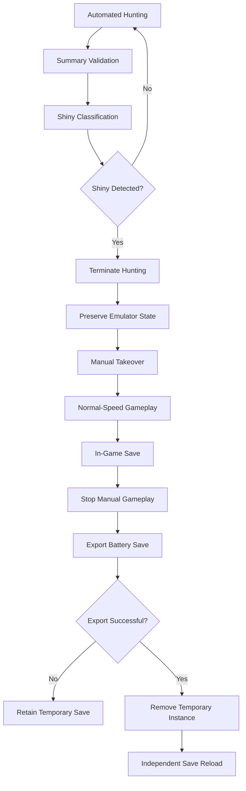
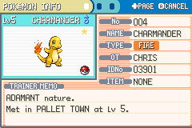
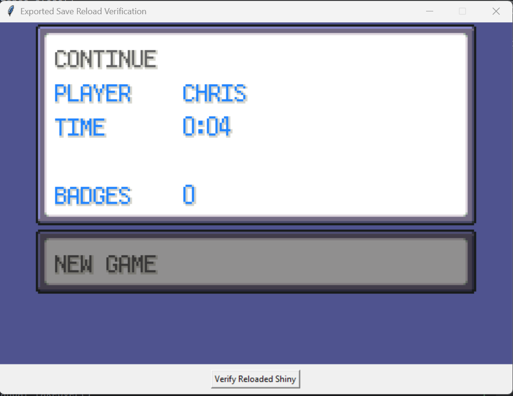

# Manual Takeover and Save Export

## Objective

Preserve the live emulator state following successful shiny detection and allow the user to resume normal gameplay. The user must be able to save their progress in-game and export the resulting battery save without modifying the original hunting profile.

The exported save must remain accessible after the temporary emulator instance is removed and must be independently loadable into a new emulator instance.

## Implementation

| Component | Responsibility |
|---|---|
| `instances/manual_takeover.py` | Transfers manual control to the user following successful shiny detection. |
| `gui/emulator_view.py` | Displays the live framebuffer, processes keyboard input, and maintains normal gameplay speed. |
| `instances/save_export.py` | Releases emulator resources and exports the battery save to a separate destination. |
| `instances/hunting_controller.py` | Terminates automated hunting following successful shiny classification. |
| `instances/library_manager.py` | Maintains isolated emulator resources and temporary instance files. |
| `tests/integration/manual_takeover.py` | Verifies manual takeover, gameplay, shiny preservation, save export, and independent reload. |

### Manual Takeover

Manual takeover is permitted only after the hunting controller reaches the `SHINY_FOUND` state and completes execution.

The takeover adapter operates directly on the existing emulator core and framebuffer. No additional emulator is initialized, and no reset or save reload is performed during the transition.

The adapter provides the frame advancement, framebuffer retrieval, and keyboard input operations required by the existing emulator widget.

Closing the takeover adapter releases active keyboard inputs without destroying the underlying emulator instance.

### Manual Gameplay

The existing `EmulatorView` widget was reused without modification.

The widget advances emulator frames at the configured game-specific frame rate, renders the live framebuffer using nearest-neighbor scaling, and processes keyboard input.

The same widget can therefore support both initial profile preparation and manual gameplay following successful shiny detection.

### Battery Save Export

Battery save export requires manual gameplay to be stopped before releasing emulator resources.

The export mechanism validates the destination, releases the native emulator core, verifies the battery save size, and writes the save to a separate `.sav` file.

The exported file is compared against the temporary battery save to verify that its contents are identical.

Export safeguards include:

- Rejecting export during active manual gameplay.
- Rejecting destinations without the `.sav` extension.
- Protecting permanent profile, ROM, and temporary instance directories.
- Preventing existing exported files from being overwritten.
- Rejecting incorrectly sized or blank battery saves.
- Removing incomplete output files if an export write or verification fails.

Temporary instance cleanup remains separate from the export operation, allowing the caller to retain the temporary save if export fails.

### Workflow

## Experimental Environment

| Property | Configuration |
|---|---|
| Game | Pokemon FireRed Rev 1 |
| Emulator | libmGBA |
| Operating System | Windows |
| Processor | AMD Ryzen 9850X3D |
| Memory | 32 GB |
| Hunting Profile | FireRed Starter |
| Target Pokemon | Charmander |
| Species ID | 004 |
| Native Framebuffer Resolution | 240 x 160 |
| Gameplay Target Frame Rate | 59.7275 FPS |
| Expected Battery Save Size | 131,072 bytes |

## Manual Takeover Verification

The initial experiment verified that manual control could be transferred to the existing hunting emulator following successful shiny classification.

A genuine automated encounter was executed. A controlled shiny screenshot was supplied to the classification pipeline to trigger hunting termination without waiting for a naturally occurring shiny encounter.

The underlying emulator state was not replaced.

### Results

| Verification | Result |
|---|---|
| Premature takeover rejection | PASS |
| Active hunting takeover rejection | PASS |
| Takeover following shiny detection | PASS |
| Original emulator core retained | PASS |
| Original framebuffer retained | PASS |
| Original temporary instance retained | PASS |
| Framebuffer retrieval | PASS |
| Manual button input | PASS |
| Manual frame advancement | PASS |
| Summary exit using B button | PASS |
| Multiple key tracking | PASS |
| Key release | PASS |
| Emulator preservation | PASS |
| Inactive frame advancement rejection | PASS |
| Temporary instance cleanup | PASS |
| Permanent save preservation | PASS |
| Permanent metadata preservation | PASS |

The experiment confirmed that the original emulator could be controlled manually without restarting the game or initializing a replacement emulator.

Exiting the Pokemon summary using the B button provided functional evidence that manual input was processed correctly.

### Implementation Corrections

The initial experiment identified an incorrect conversion of button indices into bitmasks. The libmGBA Python interface performs this conversion internally and expects button indices.

The manual takeover adapter was corrected to pass button indices directly.

The initial test also retained an additional reference to the emulator core, preventing native resources from being released before temporary file deletion on Windows.

Object identities were subsequently recorded using `id()` rather than retaining additional emulator references.

The corrected experiment completed successfully with no resource cleanup errors.

## Manual Gameplay Integration

The existing emulator widget was connected to the manual takeover adapter to verify normal-speed gameplay within the preserved hunting instance.

A controlled shiny classification triggered automatic hunting termination. Manual gameplay then continued using the original emulator.

### Frame Rate Results

| Measurement | Result |
|---|---:|
| Frames Executed | 3,787 |
| Elapsed Time | 63.4030 seconds |
| Target Frame Rate | 59.7275 FPS |
| Measured Frame Rate | 59.7290 FPS |
| Absolute Frame Rate Difference | 0.0015 FPS |
| Relative Frame Rate Deviation | Approximately 0.0025% |

The measured frame rate closely matched the configured gameplay target throughout the experiment.

### Integration Results

| Verification | Result |
|---|---|
| Existing emulator widget compatibility | PASS |
| Hunting instance preservation | PASS |
| Live framebuffer rendering | PASS |
| Manual frame advancement | PASS |
| Normal-speed gameplay | PASS |
| Manual gameplay termination | PASS |
| Key release | PASS |
| Original emulator preservation | PASS |
| Temporary instance cleanup | PASS |
| Permanent save preservation | PASS |
| Permanent metadata preservation | PASS |

The experiment demonstrated that the existing emulator widget could be reused for manual takeover without requiring a separate gameplay interface.

## Live Shiny Preservation

A controlled battery save containing a PKHeX-generated shiny Charmander was used to verify preservation of an actual shiny Pokemon within the emulator.

The controlled battery save was copied into an isolated emulator instance. The original permanent hunting profile and controlled source save remained unchanged.

The Pokemon summary was reached through manual gameplay. A capture-only test macro was used to collect the actual live framebuffer without resetting the emulator.

Unlike the previous experiments, no screenshot was injected into the classification pipeline.

### Initial Classification

| Classifier | Prediction |
|---|---|
| Border RGB Mean + Linear SVM | Shiny |
| Star HOG + Linear SVM | Shiny |
| Sprite Spatial RGB Histogram | Shiny |
| Majority Vote | 3/3 |
| Final Prediction | Shiny |

The hunting controller automatically transitioned to `SHINY_FOUND` following successful classification.

The live framebuffer remained unchanged during the transition to manual takeover.

### Manual Gameplay Preservation

Manual gameplay resumed using the same emulator core and framebuffer. After navigating away from the summary and returning to a shiny Charmander summary, the live framebuffer was classified again.

| Measurement | Before Gameplay | After Gameplay |
|---|---:|---:|
| Shiny Votes | 3/3 | 3/3 |
| Shiny Prediction | True | True |

### Preservation Results

| Verification | Result |
|---|---|
| Controlled battery save loading | PASS |
| Actual live summary validation | PASS |
| Actual shiny classification | PASS |
| Automatic hunting termination | PASS |
| Live framebuffer preservation | PASS |
| Original emulator core retained | PASS |
| Original framebuffer retained | PASS |
| Shiny summary retained during takeover | PASS |
| Shiny preservation after gameplay | PASS |
| Hunting statistics unchanged | PASS |
| Manual takeover termination | PASS |
| Temporary instance cleanup | PASS |
| Permanent save unchanged | True |
| Permanent metadata unchanged | True |
| Controlled source save unchanged | True |

*Live shiny Charmander summary captured after automatic hunting termination and manual gameplay within the original emulator instance.*

## Battery Save Export Verification

The controlled shiny battery save was loaded into another isolated emulator instance.

Following successful live shiny classification, manual gameplay was resumed and the game was saved using the standard in-game save menu.

Gameplay continued until the in-game playtime reached 0:04 before saving. This provided an observable verification point for the subsequent reload experiment.

The resulting battery save was exported to a separate destination.

### Export Results

| Property | Result |
|---|---|
| Instance ID | ffed5c98 |
| Exported Filename | FireRed_Shiny_ffed5c98.sav |
| Exported File Size | 131,072 bytes |
| Updated In-Game Playtime | 0:04 |
| Exported Data Matches Temporary Save | True |
| Exported Data Differs From Controlled Source | True |
| Export Persists After Instance Cleanup | True |

### Export Safeguards

| Verification | Result |
|---|---|
| Active gameplay export rejection | PASS |
| Permanent profile overwrite rejection | PASS |
| Invalid file extension rejection | PASS |
| Native emulator resource release | PASS |
| Battery save export | PASS |
| Exported save size verification | PASS |
| Exported save byte comparison | PASS |
| Updated in-game save data | PASS |
| Existing export overwrite rejection | PASS |
| Existing export preservation | PASS |
| Temporary instance cleanup | PASS |
| Export persistence after cleanup | PASS |
| Permanent save unchanged | True |
| Permanent metadata unchanged | True |
| Controlled source save unchanged | True |

The exported battery save remained available after the original temporary emulator instance was removed.

The exported data differed from the original controlled source save, confirming that updated battery save data was exported.

## Independent Save Reload Verification

The exported battery save was loaded into an entirely new emulator instance after the original exporting instance had been removed.

This experiment verified that the exported save did not depend on the original emulator core, framebuffer, or temporary directory.

### Independent Instance Verification

| Property | Value |
|---|---|
| Original Export Instance | ffed5c98 |
| Reload Instance | 4c00bee1 |
| Original Temporary Instance Removed | True |
| Exported Battery Save Size | 131,072 bytes |
| Reloaded Save Copy Matches Export | True |

The game successfully loaded the exported battery save and displayed the updated Continue screen.

*Continue screen displayed by the independently initialized emulator using the exported battery save. The recorded playtime of 0:04 matches the updated in-game save.*

### Reloaded Game Information

| Property | Observed Value |
|---|---|
| Player | CHRIS |
| Playtime | 0:04 |
| Badges | 0 |

The shiny Charmander summary was subsequently reached through manual gameplay and classified directly from the live framebuffer.

### Reloaded Shiny Classification

| Classifier | Prediction |
|---|---|
| Border RGB Mean + Linear SVM | Shiny |
| Star HOG + Linear SVM | Shiny |
| Sprite Spatial RGB Histogram | Shiny |
| Majority Vote | 3/3 |
| Final Prediction | Shiny |

*Live shiny Charmander summary captured after loading the exported battery save into a new emulator instance.*

### Reload Verification Results

| Verification | Result |
|---|---|
| Independent emulator initialization | PASS |
| Previous emulator removed | PASS |
| Exported save copy verification | PASS |
| Updated saved playtime | Confirmed |
| Reloaded summary validation | PASS |
| Reloaded shiny classification | PASS |
| Shiny persistence after export | PASS |
| Temporary instance cleanup | PASS |
| Exported save unchanged | True |
| Permanent save unchanged | True |
| Permanent metadata unchanged | True |
| Controlled source save unchanged | True |

The experiment established that the exported battery save independently preserved both the updated saved game and the shiny Pokemon.

## Experimental Limitations

- The initial manual takeover and gameplay experiments used controlled shiny screenshot injection to trigger hunting termination.
- The live shiny preservation, export, and reload experiments used a PKHeX-generated shiny Pokemon rather than a naturally encountered shiny.
- A capture-only test macro was used for the live shiny experiments because the controlled save already contained the target Pokemon.
- The normal-speed gameplay measurement represents a single experimental session rather than a sustained performance benchmark.
- Saved playtime was visually verified rather than automatically extracted from the battery save.
- Saved player location was included in the manual verification procedure but was not independently recorded in the experimental results.
- The live summary experiments verified preservation of a shiny Charmander matching the target species but did not independently compare unique Pokemon identifiers before and after gameplay.
- Battery save export terminates the underlying emulator core. Continued gameplay following export would require loading the exported save into another emulator instance.
- Export safeguards were verified for active gameplay, protected destinations, invalid file extensions, and existing files. Additional failure conditions, such as interrupted writes, insufficient storage, and unexpected application termination, were not experimentally evaluated.
- Production GUI integration, including user-selected export destinations and coordinated emulator lifecycle management, remains separate from these integration tests.

## Conclusion

Manual takeover, normal-speed gameplay, live shiny preservation, battery save export, and independent save reload were successfully implemented and verified.

The experiments demonstrated that successful shiny classification can terminate automated hunting while preserving the existing emulator state. The user can then resume manual gameplay, save through the game interface, and export the resulting battery save.

The exported save remained accessible after temporary instance cleanup and successfully loaded into a new emulator instance, where the preserved shiny Pokemon was again identified by all three classifiers.

All permanent hunting profile files and controlled source saves remained byte-for-byte unchanged throughout the experiments.