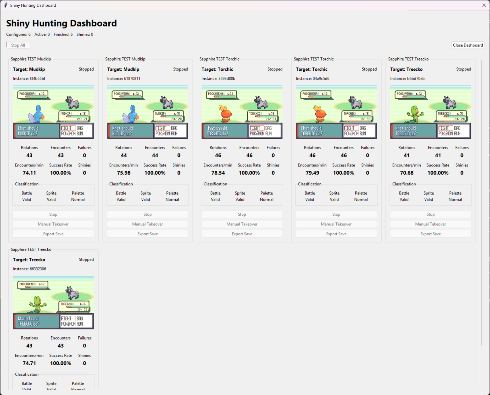

# Sapphire Integration

## Overview

Pokémon Sapphire Rev 2 was selected as the third supported game.
Unlike FireRed and LeafGreen, Sapphire requires the player to
select a starter from Birch's bag before entering a battle
against Poochyena.

The Sapphire implementation uses the existing profile management,
emulator instance management, and temporary save architecture.
However, it requires a separate automation macro and computer
vision pipeline.

## Profile Preparation

Sapphire profiles are prepared by positioning the player in front
of Birch's bag and saving through the in-game menu.

Sapphire uses a real-time clock (RTC), which introduces additional
metadata into the battery save. The existing save validation
initially rejected the extended save format.

A shared battery save validator was implemented to support both
standard and RTC-extended battery saves while preserving the
original validation requirements for FireRed and LeafGreen.

Successful profile creation and persistence were verified.

## Automation Macro

The Sapphire macro was developed using manually recorded input
timings. Three trials were conducted to establish the sequence
from emulator reset to Birch's bag.

| Input | Trial 1 (s) | Trial 2 (s) | Trial 3 (s) |
|---|---:|---:|---:|
| 1 | 4.51 | 4.05 | 3.99 |
| 2 | 5.56 | 5.30 | 5.10 |
| 3 | 6.54 | 6.49 | 6.15 |
| 4 | 8.13 | 7.74 | 7.47 |
| 5 | 9.65 | 9.05 | 8.86 |
| Bag available | 11.28 | 11.15 | 10.30 |

The longest individual input intervals were used to establish
conservative frame timings.

### Starter Selection

Torchic is highlighted by default when Birch's bag is opened.
Conditional directional inputs allow the same macro to support
all three starters.

| Starter | Species ID | Directional Input |
|---|---|---|
| Treecko | 252 | Left |
| Torchic | 255 | None |
| Mudkip | 258 | Right |

All remaining inputs are shared between the three starters.

The selected profile determines the target species passed to
the macro through the library instance manager.

### Randomized Timing

Unlike the FireRed and LeafGreen macro, Sapphire applies
randomized variance at only one point in the encounter sequence.

A randomized delay between 0 and 1791 frames is applied before
confirming the starter selection. This corresponds to a maximum
additional delay of approximately 30 emulated seconds.

Sapphire uses a time-dependent initial RNG seed when the RTC
is functioning. However, initial seed variation across emulator
resets has not yet been independently verified.

### Battle Capture Timing

Sapphire encounters are classified directly from the battle
screen rather than the Pokémon summary screen.

Shiny encounters introduce an additional sparkle animation
before the battle action menu becomes available.

Three controlled shiny encounter timing trials were conducted
to determine an appropriate screenshot delay.

| Trial | Duration (s) |
|---|---:|
| 1 | 4.25 |
| 2 | 4.25 |
| 3 | 4.24 |

The screenshot delay was increased from 200 to 270 frames to
accommodate the additional animation.

### Final Macro Schedule

| Frame | Action | Maximum Variance |
|---:|---|---:|
| 0 | Reset emulator | 0 |
| 269 | A | 0 |
| 344 | A | 0 |
| 415 | A | 0 |
| 510 | A | 0 |
| 601 | A | 0 |
| 726 | Conditional starter selection | 0 |
| 756 | A | 0 |
| 819 | A | 1791 |
| 1245 | A | 0 |
| 1515 | Screenshot | 0 |

Randomized variance carries forward to all subsequent inputs.

The final schedule has an emulated duration of approximately
25.36 to 55.35 seconds per rotation.

### Macro Verification

An initial three-rotation test was conducted using Torchic.
All three rotations successfully reached the completed battle
screen.

An additional nine-rotation test was conducted across all
three starters.

| Starter | Successful Captures | Total Captures |
|---|---:|---:|
| Treecko | 3 | 3 |
| Torchic | 3 | 3 |
| Mudkip | 3 | 3 |
| Total | 9 | 9 |

Including the initial Torchic test, 12 successful battle
captures were obtained.

Profile-dependent macro execution was also tested using the
Sapphire Treecko profile. The target species was retrieved
automatically, and the conditional directional input was
executed successfully.

These macro tests were conducted before increasing the final
screenshot delay to accommodate shiny animations.

## Computer Vision

Sapphire requires a different classification approach because
the starter is evaluated directly from its back sprite during
battle.

The detection pipeline consists of three components:

1. Battle menu verification.
2. Target back sprite verification.
3. Normal or shiny color classification.

Unlike FireRed and LeafGreen, Sapphire does not use majority
voting. Both verification components must succeed before color
classification is performed.

### Dataset

The Ruby and Sapphire dataset follows the existing FireRed
and LeafGreen directory structure.

    dataset/ruby_sapphire/
        captures/
            normal/
            shiny/
        evaluation/
            normal/
            shiny/

Six reference screenshots were collected at the native GBA
resolution of 240 by 160 pixels.

| Species | Normal Reference | Shiny Reference |
|---|---|---|
| Treecko | 252.png | 252.png |
| Torchic | 255.png | 255.png |
| Mudkip | 258.png | 258.png |

Normal references were obtained from gameplay. Shiny references
were obtained through controlled save manipulation.

All references display the completed battle introduction and
the available battle action menu.

### Regions of Interest

A separate configuration file was created for Ruby and Sapphire
at `vision/configurations/ruby_sapphire.json`.

Two regions of interest are used.

| Region | X | Y | Width | Height |
|---|---:|---:|---:|---:|
| Battle menu | 140 | 116 | 96 | 40 |
| Back sprite | 40 | 54 | 64 | 58 |

The back sprite region is shared between species verification
and color classification.

### Battle Menu Verification

Battle menu verification uses exact pixel template matching,
following the existing FireRed and LeafGreen summary validation
methodology.

The battle menu region is extracted from the reference images
and compared against the corresponding region of the captured
framebuffer.

This verifies that the expected battle menu is present before
the starter is classified.

### Back Sprite Verification

Back sprite verification uses Histogram of Oriented Gradients
(HOG) features and a multiclass linear Support Vector Machine
(SVM).

The sprite region is resized to 64 by 64 pixels before feature
extraction.

Both normal and shiny references are assigned the same species
label during training.

The predicted species must match the target species associated
with the selected profile.

### Color Classification

The existing spatial RGB histogram classifier was extended
through inheritance to accommodate the Sapphire battle
background.

Rather than masking the white and gray backgrounds found in
FireRed and LeafGreen, the Sapphire classifier creates a mask
using pixels that differ between the normal and shiny reference
sprites.

The remaining feature extraction methodology is unchanged:

- Four spatial histogram cells.
- 32 histogram bins per RGB channel.
- Histogram normalization.
- Bhattacharyya distance comparison.

The captured sprite is classified as shiny when its histogram
distance to the shiny reference is smaller than its distance
to the normal reference.

### Detection Pipeline

The Sapphire detection pipeline was implemented separately
from the existing FireRed and LeafGreen detector.

The following modules were introduced:

- `vision/battle_validator.py`
- `vision/battle_palette_classifier.py`
- `vision/battle_shiny_detector.py`

This preserves the existing FireRed and LeafGreen classification
behavior while allowing Sapphire to use its own verification
and classification methodology.

## Classifier Verification

Standalone verification was conducted using
`tests/vision/test_battle_shiny_detector.py`.

Six evaluation images were classified, consisting of one
normal and one shiny image for each starter.

### Classification Results

| Component | Successful Tests | Total Tests |
|---|---:|---:|
| Battle menu verification | 6 | 6 |
| Back sprite verification | 6 | 6 |
| Normal classification | 3 | 3 |
| Shiny classification | 3 | 3 |
| Incorrect species rejection | 12 | 12 |

All six images were classified correctly.

Each image was additionally evaluated against the two incorrect
starter species. All twelve incorrect species combinations
were rejected.

### Histogram Distance Results

| Starter | Normal-to-Shiny Distance |
|---|---:|
| Treecko | 0.896235 |
| Torchic | 0.801163 |
| Mudkip | 0.919811 |

All three starters demonstrated substantial separation between
their normal and shiny reference histograms.

The matching reference histogram distance was zero for every
evaluation image.

## Experimental Limitations

The evaluation images do not establish independent
classification accuracy because the shiny evaluation images
were copied from the reference dataset and the normal
evaluation images produced identical reference features.

The results demonstrate successful reference regression
testing and incorrect starter rejection.

Additional limitations include:

- Natural shiny encounters have not been observed.
- Invalid battle screen rejection has not been independently
  evaluated.
- The multiclass SVM is limited to the three supported starter
  species and does not independently reject unfamiliar sprites.
- RNG seed variation across emulator resets remains unverified.
- The updated screenshot delay requires automated verification
  against controlled shiny encounters.
- RTC-compatible shiny save export remains unverified.

## Integration Status

The following components have been completed:

- Sapphire game registration.
- RTC-compatible battery save validation.
- Profile creation and persistence.
- Conditional starter selection macro.
- Profile-dependent macro execution.
- Battle capture timing measurements.
- Normal and shiny reference dataset.
- Battle menu verification.
- Back sprite verification.
- Sprite color classification.
- Standalone classifier regression testing.

The remaining integration work includes connecting the Sapphire
detector to the hunting pipeline, updating the hunting dashboard
and instance panels, verifying shiny preservation and save
export, and testing concurrent hunting across supported games.
## Automated Hunting Integration

The Sapphire detection pipeline was integrated into the existing
instance manager, hunting controller, and graphical hunting
dashboard.

The hunting controller now uses a common encounter validation
field (`valid_encounter`) rather than relying exclusively on
summary screen validation. This allows the same hunting controller
to support both summary-based and battle-based shiny detection.

The hunting worker required no modifications because classification
results are already forwarded independently of the detection method.

The existing instance isolation, hunting state management, encounter
statistics, and stopping behavior were retained.

### Backend Verification

Ten automated classified hunting rotations were performed for each
of the three supported Sapphire starters.

| Starter | Rotations | Valid Encounters | Failures | Success Rate |
|---|---:|---:|---:|---:|
| Treecko | 10 | 10 | 0 | 100% |
| Torchic | 10 | 10 | 0 | 100% |
| Mudkip | 10 | 10 | 0 | 100% |
| Total | 30 | 30 | 0 | 100% |

All 30 encounters passed battle screen and target sprite validation
and were classified as normal.

Temporary instance cleanup was verified for each test, and all
three tests terminated successfully.

## Graphical Hunting Integration

The hunting dashboard now selects the classification display
according to the vision configuration associated with each
profile's registered game.

FireRed and LeafGreen retain their existing classification display:

- Border
- Star
- Palette

Sapphire uses the following display:

- Battle
- Sprite
- Palette

Battle and Sprite indicate encounter validation results, while
Palette indicates the shiny classification result.

The shiny notification was also updated to display the appropriate
detection result. FireRed and LeafGreen display the number of
positive classifier votes, while Sapphire displays the positive
palette classification.

These changes allow different detection pipelines to operate
within the same graphical hunting dashboard without requiring
separate game-specific interfaces.

## Concurrent Hunting Verification

Six Sapphire hunting instances were configured through the
graphical application, with two instances assigned to each
supported starter.

All instances performed automated resets, starter selection,
battle screen capture, encounter validation, and shiny
classification concurrently.

### Individual Instance Results

| Instance | Starter | Rotations | Valid Encounters | Failures | Encounters/min |
|---|---|---:|---:|---:|---:|
| f34b55bf | Mudkip | 43 | 43 | 0 | 74.12 |
| 61870811 | Mudkip | 44 | 44 | 0 | 75.97 |
| 3593d88b | Torchic | 46 | 46 | 0 | 78.54 |
| 04a9c5d6 | Torchic | 46 | 46 | 0 | 79.49 |
| b6bd70eb | Treecko | 41 | 41 | 0 | 70.69 |
| 66332306 | Treecko | 43 | 43 | 0 | 74.72 |
| Total | | 263 | 263 | 0 | 453.53 |

### Combined Starter Results

| Starter | Instances | Valid Encounters | Failures | Success Rate |
|---|---:|---:|---:|---:|
| Mudkip | 2 | 87 | 0 | 100% |
| Torchic | 2 | 92 | 0 | 100% |
| Treecko | 2 | 84 | 0 | 100% |
| Total | 6 | 263 | 0 | 100% |

All 263 completed rotations produced valid encounters with no
failed rotations. All encounters were classified as normal.

The graphical dashboard correctly displayed the selected starter,
live framebuffer, encounter statistics, and Sapphire-specific
classification results for each instance.

Differences in starter HP values were observed between instances,
demonstrating variation in generated encounters.

*Figure: Six concurrent Sapphire hunting instances following
successful completion and stopping of 263 automated hunting
rotations.*

### Performance

The six concurrent instances achieved a combined encounter rate
of approximately 453.53 encounters per minute.

Individual instance encounter rates ranged from approximately
70.69 to 79.49 encounters per minute.

Framebuffer capture remained approximately 10 FPS per instance
during concurrent hunting.

Sapphire achieved a substantially higher observed encounter rate
than the previously tested FireRed and LeafGreen implementations.
The Sapphire macro requires fewer menu interactions because
classification occurs directly within the initial battle rather
than on the Pokemon summary screen.

The combined encounter rate represents the sum of the individual
instance encounter rates. These results were not obtained through
a controlled performance comparison between games.

### Stopping and Shutdown

All six hunting instances successfully responded to the Stop All
operation.

The dashboard reported zero active instances and six finished
instances. All emulator instances subsequently closed, and the
application terminated with exit code 0.

## Updated Verification Summary

| Verification | Result |
|---|---|
| Game registration | Passed |
| RTC-compatible save validation | Passed |
| Permanent profile creation | Passed |
| Profile persistence | Passed |
| Conditional starter selection | Passed |
| Randomized encounter timing | Passed |
| Battle screen validation | Passed |
| Target sprite validation | Passed |
| Controlled normal and shiny classification | Passed |
| Incorrect starter rejection | Passed |
| Automated backend hunting | Passed |
| Game-specific graphical classification display | Passed |
| Six-instance concurrent hunting | Passed |
| Stop All operation | Passed |
| Application termination | Passed |
| Controlled shiny notification | Pending |
| Manual takeover following shiny detection | Pending |
| RTC-compatible shiny save export | Pending |
| Mixed-game concurrent hunting | Pending |

## Experimental Limitations

The automated backend and graphical hunting tests produced a
combined total of 293 valid encounters with no failed rotations.

However, no naturally occurring shiny encounters were detected
during these tests. Consequently, the observed 100% encounter
validation rate should not be interpreted as a demonstrated
100% shiny detection accuracy.

Controlled shiny classification was previously verified using
prepared reference and evaluation images. These images do not
constitute a fully independent evaluation dataset.

Additional verification is required to confirm shiny notification,
encounter preservation, manual takeover, and save export within
the integrated Sapphire hunting workflow.

The observed variation in starter statistics demonstrates
encounter variation but does not establish statistical
independence between generated encounters.